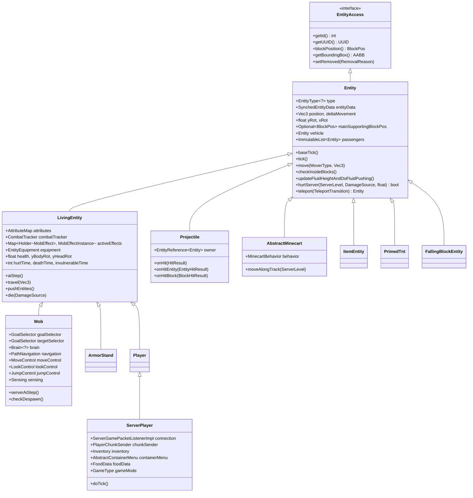

# 实体系统（Entity System）详细实现规划（对齐 Minecraft Java Edition 26.1）

> **文档性质说明（遵循 [AGENTS.md](../AGENTS.md) 约束）**  
> 本文档区分**「当前已实现边界」**与**「26.1 目标形态」**。除第 1 节列出的已落地简单实体子集外，其余章节（`E-1 ~ E-6`）均为**尚未实现的详细工程规划**。在对应阶段完成并通过 CTest 与真实 26.1 服务端逐刻差分验证前，不声称与原版等价。

---

## 1. 当前已实现边界（Current Baseline）

在完成本次文件模块化拆分后，当前实体子系统由 `include/redstone/entity.hpp`、`include/redstone/entity_codec.hpp` 与 `src/entity/` 下的 5 个模块组成：

| 模块文件 | 当前已实现能力 | 当前明确未实现边界（`// TODO`） |
|---|---|---|
| `src/entity/internal.hpp` | AABB 轴向扫掠碰撞（`collideAxis`）、射线包围盒相交（`rayBox`）、`SectionPos` 64-bit 编码与 `forEachEntitySection` 空间查询（含 `CHONKY_ENTITY_SEARCH_GRACE = 2/4`） | 未实现完整 `VoxelShape` 布尔运算与实体硬碰撞箱（Boat / Shulker） |
| `src/entity/entity_base.cpp` | `Entity` 基类、`setPos` / `reapplyPosition`、`move`（XYZ 轴序 `Y -> X -> Z` 或 `Y -> Z -> X`）、`moveTowardsClosestSpace`、`updateWaterState`、岩浆着火/伤害、下界传送门碰撞登记（`handlePortal`）、仙人掌与细雪基础方块效果、`baseTick` | 无 `MoverType` 区分；无 `mainSupportingBlockPos` 边缘支撑；`updateFluidHeightAndDoFluidPushing` 仅标记 `wasTouchingWater` 而不施加水流推力；`applyEffectsFromBlocks` 仅检查脚下方块而非完整移动路径包围盒扫掠（`InsideBlockEffectApplier`） |
| `src/entity/simple_entities.cpp` | `ItemEntity`（生成初速度、水/岩浆上浮、地面摩擦、距离合并、6000 tick 消失、漏斗唤醒）、`PrimedTnt`（引信倒计时、重力移动、80 tick 爆炸）、`FallingBlockEntity`（沙子等下落、落地放置或掉落物品） | `FallingBlockEntity` 尚未支持混凝土粉末遇水固化、铁砧摔落损耗与砸伤实体（`Fallable.onLand` / `causeFallDamage`）、带 `block_entity_data` 的下落方块 |
| `src/entity/minecart.cpp` | 空矿车 `Minecart`、原版 `OldMinecartBehavior` 4 种铁轨（普通/动力/探测/激活）吸附、坡道、弯道、`getPos` 视觉插值回退、矿车互撞推挤与拾取 `ItemEntity` | 未实现 6 种派生矿车（箱子/漏斗/熔炉/TNT/命令方块/刷怪笼矿车）、未实现实验性 `NewMinecartBehavior`、无乘客骑乘系统 |
| `src/entity/world_entities.cpp` | `World` 实体容器、UUID 唯一性表、`entitySections_` 分区索引、活塞实体移动、方块碰撞收集、`World::clip` DDA 射线检测、`World::tickEntities` 主循环 | 仅注册 4 种 `EntityType`；无 `PersistentEntitySectionManager` 独立状态机（`HIDDEN / TRACKED / TICKING`）；未支持实体仅保留日志入口 |
| `src/entity/explosion.cpp` | `ServerExplosion` 1352 条射线网格、`seenPercent` 遮挡采样、4096 槽射线步进缓存、实体冲击波伤害与击退、连锁引爆 TNT、掉落物归并 | 无风弹（`WindCharge`）特殊爆炸计算、无玩家/生物护甲与爆炸保护附魔减伤 |
| `src/entity_codec.cpp` | `entities/r.x.z.mca` 中 `minecraft:item`、`minecraft:tnt`、`minecraft:falling_block`、`minecraft:minecart` 4 种实体的 NBT 编解码与跨区块迁移写回安全门控 | 遇到其他实体 ID 或含 `Passengers` 的实体时显式拒绝接管/写回，不静默丢弃 |
| `src/net/session_tracking.cpp` | 协议 775 `add_entity`、`remove_entities`、`teleport_entity`、`move_entity_pos*`、`set_entity_motion`、`set_entity_data`（物品槽位、TNT 引信、下落方块 stateId） | 无通用 `SynchedEntityData` 脏位表，硬编码特定实体字段；玩家自身尚未作为 `World` 内的权威 `ServerPlayer` 实体存在 |

---

## 2. 26.1 原版实体核心架构对照（Vanilla 26.1 Reference）

在 Minecraft Java Edition 26.1 中，服务端实体系统由以下核心层次构成：



### 2.1 `ServerLevel.tick` 中的实体阶段精确顺序

根据 26.1 `ServerLevel.java` 与 `ServerChunkCache.java`，单刻内与实体相关的完整时序为：

1. **游戏时间与计划刻阶段**：
   - `tickTime()`：推进 `gameTime` 与维度时钟。
   - `blockTicks.tick(gameTime, 65536, this::tickBlock)`
   - `fluidTicks.tick(gameTime, 65536, this::tickFluid)`
2. **`ServerChunkCache.tick` 阶段**：
   - `distanceManager.runAllUpdates(chunkMap)`：应用加载票变更。
   - `tickChunks()`：
     - 若 `doMobSpawning` 开启且玩家非旁观者，先统计 `NaturalSpawner.createState` 各 `MobCategory` 数量并执行 `NaturalSpawner.spawnForChunk`（生物自然生成在随机刻附近同一区块遍历中完成）。
     - 随机刻（`tickChunk`）。
   - `chunkMap.broadcast()`：合并广播脏方块与光照变化。
   - `chunkMap.tick()`：遍历 `entityMap`（`TrackedEntity` / `ServerEntity.sendChanges()`），**在当前刻实体移动前**将上一刻累积的位移/旋转/属性/元数据脏位同步给追踪客户端。
3. **方块事件阶段**：
   - `runBlockEvents()`：执行活塞伸出/收回等方块事件（活塞在此阶段创建 `PistonMovingBlockEntity` 并执行初始扫掠推动实体）。
4. **实体主循环阶段（`ServerLevel.tick` -> `entityTickList.forEach`）**：
   - 保护遍历列表 `entityTickList`（遍历期间新增或删除实体通过 COW / 快照隔离，不破坏当前遍历顺序）。
   - 对每个非移除实体：
     - `checkDespawn()`：距离玩家超过 `despawnDistance`（128 格）立即消失，超出 `noDespawnDistance`（32 格）按 `randomTick` 概率消失。
     - 检查实体所在区块是否处于 `entityTicking`（加载等级 $\le 31$ 且周围 $5\times 5$ 区块 `FULL` 且实体区段已加载）。
     - **非骑乘根实体**：`tickNonPassenger(entity)` -> 保存旧坐标 `xOld/yOld/zOld/yRotO/xRotO` -> `entity.tick()` -> `updatePos()` -> 递归对每个 `passenger` 调用 `tickPassenger(vehicle, passenger)`。
     - **跨维度传送排空**：处理本刻 `handlePortal` 到期的实体，执行 `Entity.teleport(TeleportTransition)`。
5. **方块实体阶段（`tickBlockEntities`）**：
   - 推进 `PistonMovingBlockEntity.tick`（0.5 -> 1.0 步进并推动实体）、`HopperBlockEntity.tick`（吸取/推入容器或吸取上方 `ItemEntity` / `MinecartHopper`）、熔炉/酿造台等。
6. **实体分区管理器收尾（`entityManager.tick()`）**：
   - `PersistentEntitySectionManager.tick()`：处理区块可见性迁移（`Visibility`: `HIDDEN` $\leftrightarrow$ `TRACKED` $\leftrightarrow$ `TICKING`），以及异步卸载落盘队列。

---

## 3. 目标模块与目录拆分设计（Target File Layout）

为避免未来新增数十种实体后单文件再度膨胀到数千行，实体系统将继续沿用 `include/redstone/entity/` 与 `src/entity/` 的分层目录结构：

```text
include/redstone/
├── entity.hpp                        # 顶层聚合头文件（保持现有 include 兼容）
└── entity/
    ├── entity_type.hpp               # 26.1 EntityType 注册表（由 assets/protocol775/entities.tsv 驱动）、EntityDimensions、MobCategory
    ├── synched_data.hpp              # SynchedEntityData、EntityDataAccessor<T>、EntityDataSerializer（对齐 entity_data_serializers.tsv）
    ├── entity_base.hpp               # Entity 基类、MoverType、RemovalReason、Ride/Passenger、PortalProcessor、InsideBlockEffectApplier
    ├── section_manager.hpp           # EntitySection<T>、EntitySectionStorage<T>、PersistentEntitySectionManager、Visibility 状态机
    ├── damage.hpp                    # DamageType、DamageSource、CombatTracker、DamageScaling
    ├── attributes.hpp                # Attribute、AttributeModifier、AttributeInstance、AttributeMap（对齐 attributes.tsv）
    ├── mob_effects.hpp               # MobEffect、MobEffectInstance（对齐 mob_effects.tsv）
    ├── living_entity.hpp             # LivingEntity 基类、装备栏、受伤/击退/状态效果/攀爬/游泳物理
    ├── player.hpp                    # Player 与 ServerPlayer（连接 Session、背包、视距、床睡眠、饥饿度）
    ├── mob.hpp                       # Mob、PathfinderMob、GoalSelector、Brain、PathNavigation、MoveControl/LookControl/JumpControl
    ├── natural_spawner.hpp           # NaturalSpawner、SpawnState、SpawnPlacements
    ├── simple_entities.hpp           # ItemEntity、PrimedTnt、FallingBlockEntity、ExperienceOrb、ArmorStand、EndCrystal
    ├── vehicles.hpp                  # AbstractMinecart + 7 种矿车、OldMinecartBehavior / NewMinecartBehavior、Boat / ChestBoat
    └── projectiles.hpp               # Projectile、AbstractArrow、ThrownItemProjectile、WindCharge、FireworkRocketEntity、FishingHook

src/entity/
├── internal.hpp                      # 内部几何/碰撞/区段辅助内联函数
├── entity_type.cpp                   # 26.1 全部实体类型静态表与查询
├── synched_data.cpp                  # 脏位追踪与协议 775 wire 编码器
├── entity_base.cpp                   # Entity 基础生命周期、物理移动、支撑方块、流体推力、方块内效果、骑乘树
├── section_manager.cpp               # 实体分区索引、ChunkEntities 生命周期与可见性回调
├── explosion.cpp                     # ServerExplosion 射线、遮挡缓存、冲击波与护甲减伤
├── simple_entities.cpp               # ItemEntity、PrimedTnt、FallingBlockEntity（含铁砧/混凝土粉末）、ExperienceOrb
├── minecart.cpp                      # 空矿车与派生矿车（漏斗/箱子/TNT/熔炉矿车）及轨道物理
├── vehicles_boat.cpp                 # 船与竹筏流体浮力及碰撞物理
├── projectiles.cpp                   # 投掷物与箭矢射线步进、方块/实体命中回调（靶标块、按钮、合唱花、TNT 引燃）
├── decorative_entities.cpp           # 盔甲架、物品展示框、画、末影水晶
├── living_entity.cpp                 # LivingEntity 属性、伤害结算、药水效果、travel() 流体/陆地/滑翔物理
├── player.cpp                        # ServerPlayer 权威实体与 net::Session 双向桥接
├── mob_ai.cpp                        # 寻路（A* WalkNodeEvaluator）、控制器、GoalSelector 与核心红石相关生物（村民/铁傀儡/史莱姆/潜影贝）
├── natural_spawner.cpp               # 生物自然生成循环与刷怪上限统计
└── world_entities.cpp                # World 实体接口、射线裁剪与主循环调度
```

---

## 4. 分阶段详细实现路线图（Phased Implementation Plan）

### 阶段 E-1：实体基础框架、元数据同步、精确碰撞与流体/方块交互闭环

**目标**：把 `Entity` 基类从“4 种实体的最小公倍数”升级为完整复刻 26.1 `Entity.java` 的通用基座。

#### E-1.1 全量 `EntityType` 注册表与 `EntityDimensions`
- **源码依据**：`net.minecraft.world.entity.EntityType`、`EntityDimensions`、`EntityAttachments`；导出资产 `assets/protocol775/entities.tsv`。
- **实现细节**：
  1. 解析或预编译生成 26.1 全部 `EntityType` 条目（含协议数值 ID、资源名、`MobCategory`、宽 `width`、高 `height`、眼高 `eyeHeight`、`fireImmune`、`clientTrackingRange`、`updateInterval`、` trackDelta`）。
  2. 引入 `Pose`（`STANDING`、`FALL_FLYING`、`SLEEPING`、`SWIMMING`、`SPIN_ATTACK`、`CROUCHING`、`LONG_JUMPING`、`DYING` 等）与 `getDimensions(Pose)`，当 `Pose` 变化时自动调用 `refreshDimensions()` 重新计算 `boundingBox`（若新包围盒与方块冲突则用 `moveTowardsClosestSpace` 微调）。

#### E-1.2 `SynchedEntityData` 通用同步数据表
- **源码依据**：`net.minecraft.network.syncher.SynchedEntityData`、`EntityDataAccessor`、`EntityDataSerializers`；导出资产 `assets/protocol775/entity_data_serializers.tsv`。
- **实现细节**：
  1. 每个 `Entity` 持有 `SynchedEntityData entityData_`。基类固定定义索引 `0..7`：
     - `0` (`BYTE`): `DATA_SHARED_FLAGS_ID`（bit0 着火、bit1 潜行、bit3 疾跑、bit4 游泳、bit5 隐身、bit6 发光、bit7 鞘翅滑翔）
     - `1` (`INT`): `DATA_AIR_SUPPLY_ID`（默认 300）
     - `2` (`OPTIONAL_COMPONENT`): `DATA_CUSTOM_NAME`
     - `3` (`BOOLEAN`): `DATA_CUSTOM_NAME_VISIBLE`
     - `4` (`BOOLEAN`): `DATA_SILENT`
     - `5` (`BOOLEAN`): `DATA_NO_GRAVITY`
     - `6` (`POSE`): `DATA_POSE`
     - `7` (`INT`): `DATA_TICKS_FROZEN`
  2. 派生类按原版定义追加固定槽位（例如 `ItemEntity` 的 index `8: ITEM_STACK`、`PrimedTnt` 的 index `8: FUSE_ID` 与 `9: BLOCK_STATE_ID`、`FallingBlockEntity` 的 index `8: START_POS`）。
  3. 每次 `entityData_.set(accessor, value)` 时，若值改变则标记对应 `DataItem` 为 `dirty = true` 并置位 `isDirty = true`。
  4. 在 `ServerEntity.sendChanges()`（`src/net/session_tracking.cpp`）中统一调用 `packDirty()` 生成 `set_entity_data` 包；新追踪玩家进入时调用 `getNonDefaultValues()` 发送非默认值，消除硬编码。

#### E-1.3 `MoverType`、`mainSupportingBlockPos` 边缘支撑与完整 `Entity.move`
- **源码依据**：`Entity.java` 的 `move(MoverType, Vec3)`、`collide(Vec3)`、`updateSupportingBlock(boolean, Vec3)`、`findSupportingBlock(Entity, AABB)`、`getOnPos(float)`。
- **实现细节**：
  1. 区分 `MoverType::{Self, Player, Piston, ShulkerBox, Shulker}`：
     - `Piston` 移动使用单轴 0.51 限幅与 `pistonDeltas` 去重（已实现，需统一进 `move(MoverType::Piston, ...)`）。
  2. 实现 **`mainSupportingBlockPos`**：
     - 当实体站在方块边缘（脚底中心点下方是空气，但 AABB 水平边缘搭在邻格方块或栅栏/墙/楼梯碰撞箱上）时，通过向下收缩 `[minX, minY - 1e-6, minZ, maxX, minY, maxZ]` 查找距离实体水平中心最近的碰撞支撑块 `mainSupportingBlockPos`。
     - `getBlockPosBelowThatAffectsMyMovement()` 与 `getOnPos()` 优先返回 `mainSupportingBlockPos`，修复实体站在冰块/粘液块/灵魂沙边缘时的摩擦力与弹跳判定。
  3. **台阶自动跨步（`maxUpStep()`）**：
     - 当水平移动发生碰撞（`horizontalCollision`）且实体 `onGround || ( verticalCollision && movement.y < 0 )` 且 `maxUpStep() > 0` 时，执行原版 `collectCandidateStepUpHeights` 尝试向上抬升跨越台阶。
  4. **实体硬碰撞箱（Entity-to-Entity Hard Collisions）**：
     - `World::getEntityCollisions(const Entity *source, const Aabb &box)`：收集 `canBeCollidedWith()` 为 `true` 的实体（如 `Boat`、`Shulker`）以及 `source->canCollideWith(other)` 为 `true` 的实体（如矿车/船碰撞规则），将它们的 AABB 并入 `collide()` 的碰撞体列表中。

#### E-1.4 流体高度与水流推力（`updateFluidHeightAndDoFluidPushing`）
- **源码依据**：`Entity.java:updateInWaterStateAndDoFluidPushing`、`updateFluidHeightAndDoFluidPushing(TagKey<Fluid>, double)`、`FlowingFluid.getFlow(BlockGetter, BlockPos, FluidState)`。
- **实现细节**：
  1. 取 `boundingBox.deflate(0.001)` 覆盖的所有整数方块坐标 `(x, y, z)`。
  2. 若区块未加载且 `isPushedByFluid()` 为真，直接返回 `false`（原版防止未加载区边缘水流推入）。
  3. 对每个匹配的流体（`FluidTag::Water` 系数 `0.014`，`FluidTag::Lava` 主世界 `0.0023333333333333335` / 下界 `0.007`）：
     - 计算流体表面高度 `fluidHeight = y + fluidState.getHeight(level, pos)`。
     - 若 `fluidHeight >= box.minY`，更新浸没深度 `submergedHeight = fluidHeight - box.minY`，并调用 `fluidFlowVector(world, pos, fluidState)`（由 `src/fluid_flow.cpp` 导出）累加流向向量 `flow`。
  4. 归一化或按原版规则缩放 `flow * scale`，若 `deltaMovement.length() < 0.003 && flow.length() > 0.0045` 则保底放大至 `0.0045`，最终 `deltaMovement += flow` 并记录 `fluidHeight[tag]` 及 `wasEyeInWater`。
  5. 这将直接补齐 `PLAN.md` 阶段 4 的 **`F-9b`（流体对实体的作用：水流推动物品、TNT、下落方块、矿车）**！

#### E-1.5 移动路径方块内效果应用器（`InsideBlockEffectApplier` / `checkInsideBlocks`）
- **源码依据**：26.1 `Entity.checkInsideBlocks(List<Movement>, InsideBlockEffectApplier)`、`BlockBehaviour.entityInside`。
- **实现细节**：
  1. 在 `Entity::move` 中记录本刻从起点到终点的移动轨迹段 `Movement{from, to}`。
  2. 按 26.1 的 `InsideBlockEffectApplier.StepBasedCollector` 收集移动路径扫过的方块，按顺序触发 `entityInside(BlockState, World, Pos, Entity, InsideBlockEffectApplier)`：
     - **气泡柱（`BubbleColumnBlock`）**：表面加速上抛或下拽，内部产生垂直加速度。
     - **蜘蛛网（`WebBlock`）**：设置 `makeStuckInBlock(state, {0.25, 0.05, 0.25})`。
     - **细雪（`PowderSnowBlock`）**：减速 `{0.9, 1.5, 0.9}`、灭火、增加 `ticksFrozen`。
     - **甜浆果丛（`SweetBerryBushBlock`）**、**仙人掌（`CactusBlock`）**、**篝火（`CampfireBlock`）**、**火焰（`BaseFireBlock`）**、**熔岩炼药锅 / 水炼药锅 / 细雪炼药锅**。
     - **探测铁轨（`DetectorRailBlock`）**、**测重压力板 / 木压力板 / 石压力板**、**绊线（`TripWireBlock`）**：统一收敛到 `entityInside` 触发脉冲，不再散落在特定实体 `tick()` 中。
     - **下界传送门 / 末地传送门 / 末地折跃门**：通过 `PortalProcessor` 记录传送状态与冷却。

#### E-1.6 骑乘树（Passengers & Vehicle）
- **源码依据**：`Entity.startRiding`、`stopRiding`、`addPassenger`、`removePassenger`、`tickRiding`、`positionRider`。
- **实现细节**：
  1. `Entity` 维护 `std::weak_ptr<Entity> vehicle_` 与 `std::vector<std::shared_ptr<Entity>> passengers_`。
  2. 防止循环骑乘（`hasPassenger` 祖先检查）。
  3. `World::tickEntities` 仅从顶层非乘客实体（`!entity->isPassenger()`）入口调用 `tickNonPassenger`，在父实体 `tick()` 后按 `positionRider(passenger)` 更新乘客坐标并递归 `tickPassenger`。

---

### 阶段 E-2：补齐非生物功能实体（红石与技术向核心）

**目标**：优先补齐所有参与红石机器、物流、弹射物触发与方块的非生物实体。

#### E-2.1 `FallingBlockEntity` 完整行为补齐
- **源码依据**：`FallingBlockEntity.java`、`AnvilBlock.java`、`ConcretePowderBlock.java`、`Fallable.java`。
- **实现细节**：
  1. **支持全部 `Fallable` 方块**：沙子、红沙、沙砾、可疑的沙子/沙砾、龙蛋、铁砧（3 个损坏阶段）、16 色混凝土粉末、脚手架、滴水石锥（`PointedDripstoneBlock`）。
  2. **混凝土粉末遇水固化**：
     - 在 `FallingBlockEntity::tick` 中，若 `blockState` 为混凝土粉末，沿着 `position -> position + deltaMovement` 做流体射线检测（`ClipContext.Fluid.SOURCE_ONLY`），或落地位置 `fluidState.is(FluidTag::Water)` 时，立即转化为对应颜色的混凝土方块。
  3. **铁砧与滴水石锥摔落伤害（`causeFallDamage`）**：
     - 当 `hurtEntities == true` 且下落高度 `ceil(fallDistance) - 1 > 0` 时，对落点 AABB 内的实体造成 `min(floor(d * fallDamagePerDistance), fallDamageMax)` 的 `falling_anvil` / `falling_stalactite` 伤害；铁砧按 `0.05 + d * 0.05` 概率调用 `AnvilBlock.damage(state)` 降级或碎裂并触发 `LevelEvent.SOUND_ANVIL_BROKEN / LAND`。
  4. **`blockData`（方块实体 NBT）保留**：支持命令或刷怪生成的携带容器/方块实体数据的下落方块在落地时恢复方块实体。

#### E-2.2 派生矿车全族（Minecart Variants）与 `NewMinecartBehavior`
- **源码依据**：`AbstractMinecart`、`AbstractMinecartContainer`、`MinecartChest`、`MinecartHopper`、`MinecartTNT`、`MinecartFurnace`、`OldMinecartBehavior`、`NewMinecartBehavior`。
- **实现细节**：
  1. **`MinecartChest`（箱子矿车）**：
     - 继承 `Minecart` + 27 格容器接口（对接 `include/redstone/containers.hpp`）。
     - 经过探测铁轨时，旁侧比较器可通过 `DetectorRailBlock.getAnalogOutputSignal` 读取箱子矿车满载度信号（1~15）。
     - 破坏时掉落箱子与内部物品（或按 26.1 掉落带内容的物品 / 散落物）。
  2. **`MinecartHopper`（漏斗矿车）**：
     - 5 格容器 + `enabled` 状态（默认为 `true`；经过未激活的激活铁轨时 `enabled = false`，经过充能激活铁轨时 `enabled = true`）。
     - 每刻若 `enabled == true` 且不处于冷却，自动调用 `suckInItems()`（从上方 1 格容器抽物品，或吸取上方碰撞箱内的 `ItemEntity`，速率高于普通漏斗：每刻尝试吸取 1 个物品，无 8 tick 传输冷却限制！）。
  3. **`MinecartTNT`（TNT 矿车）**：
     - 经过充能激活铁轨时调用 `primeFuse()`（`fuse = 80`）。
     - 高速撞击方块（水平碰撞且速度平方 $\ge 0.01$）或从高处坠落（`fallDistance >= 3.0`）或被火焰/爆炸/火箭命中时立即爆炸（爆炸威力随速度平方缩放，上限 $\le 5.0$，且铁轨本身受保护不被自身破坏）。
  4. **`MinecartFurnace`（动力矿车）**：
     - `fuel` 计数器与 `xPush` / `zPush` 推力方向，消耗煤炭产生牵引力推动同轨矿车。
  5. **可选实验特性 `NewMinecartBehavior`**：通过世界 `enabled_features` 开关切换 `OldMinecartBehavior` 与 `NewMinecartBehavior`。

#### E-2.3 投掷物与弹射物系统（Projectiles）
- **源码依据**：`Projectile`、`ProjectileUtil`、`AbstractArrow`、`Arrow`、`SpectralArrow`、`ThrownTrident`、`ThrownEnderpearl`、`Snowball`、`Egg`、`ThrownPotion`、`FireworkRocketEntity`、`WindCharge`、`FishingHook`。
- **实现细节**：
  1. **发射源对接**：
     - **发射器（`DispenserBlock`）**：补齐 `DispenseItemBehavior`，当发射箭、三叉戟、雪球、鸡蛋、末影珍珠、药水、经验瓶、烟花火箭、风弹、火焰弹、船、矿车、水桶/岩浆桶、打火石、剪刀、骨粉、盔甲架时，在发射器朝向偏移 `(0.7, 0.7, 0.7)` 处生成对应实体并赋予精确初速度与随机散布（高斯噪声 `triangle(0.0, 0.0172275 * uncertainty)`）。
  2. **弹道步进与碰撞检测**：
     - 每刻调用 `World::clip` 检测 `pos -> pos + deltaMovement` 的方块命中 `BlockHitResult`；再调用 `ProjectileUtil::getEntityHitResult` 在膨胀 `1.0` 的轨迹包络内检测最近的 `canHitEntity` 实体命中 `EntityHitResult`。
  3. **方块与红石触发回调（`onHitBlock`）**：
     - **靶标方块（`TargetBlock`）**：根据命中点离方块面中心的 UV 距离计算 `1..15` 红石信号强度，调度 `20 tick`（箭/三叉戟）或 `8 tick`（其他投掷物）脉冲！
     - **木按钮（`ButtonBlock`）**：箭或三叉戟插在木按钮上时持续保持按钮按下，直到箭消失或被拔起。
     - **压力板 / 绊线 / 钟（`BellBlock`） / 紫颂花（`ChorusFlowerBlock`） / 饰纹陶罐（`DecoratedPotBlock`） / 滴水石锥断裂**。
     - **着火箭引燃 TNT 与未点燃篝火**。
  4. **末影珍珠加载票（`ThrownEnderpearl`）**：
     - 在 26.1 中，飞行中的末影珍珠每刻或跨区块时向 `WorldChunkManager` 投递 `TicketType.ENDER_PEARL`（等级 `31 / EntityTicking`，超时 40 tick），确保远距离珍珠传输线持续加载！
  5. **风弹（`WindCharge`）**：
     - 命中时触发 `EXPLOSION_EMITTER` 级别的无方块破坏冲击波，可翻转门、活板门、栅栏门、按钮、拉杆、熄灭蜡烛并摇响钟（`ExplosionDamageCalculator` 特殊分支）。

#### E-2.4 船/竹筏、盔甲架、展示框、末影水晶与经验球
- **`Boat` / `ChestBoat` / `Raft`**：水面浮力计算、船桨状态、硬碰撞箱（可作为红石机器中的精密坐标对齐垫片）、箱子船与漏斗交互。
- **`ArmorStand`**：重力、Marker 模式、装备穿戴、活塞推动与水流推动、压力板触发。
- **`ItemFrame` / `GlowItemFrame`**：附着面合法性校验（`survives()`）、8 向旋转、**比较器读取物品旋转角度（1~8 级信号）**、被弹射物或爆炸击落。
- **`EndCrystal`**：受到任意伤害立即触发 6.0 威力爆炸。
- **`ExperienceOrb`**：水流推动、向最近玩家吸附、同值合并、修补附魔结算。

---

### 阶段 E-3：`LivingEntity`、属性系统、伤害结算与状态效果

**目标**：建立完整的活体实体物理与数值模型，支撑玩家与生物。

1. **属性系统（`AttributeMap` & `AttributeInstance`）**：
   - 从 `assets/protocol775/attributes.tsv` 载入 `minecraft:max_health`、`movement_speed`、`knockback_resistance`、`attack_damage`、`armor`、`armor_toughness`、`step_height`、`gravity`、`safe_fall_distance`、`fall_damage_multiplier`、`water_movement_efficiency`、`explosion_knockback_resistance` 等属性。
   - 支持三阶段 `AttributeModifier::Operation`：`ADD_VALUE`、`ADD_MULTIPLIED_BASE`、`ADD_MULTIPLIED_TOTAL`。
2. **伤害系统（`DamageSource` & `DamageTypes`）**：
   - 从 `assets/protocol775/damage_types.tsv` 载入全部伤害类型。
   - 实现 `LivingEntity::hurtServer`：
     - 10 tick（`invulnerableTime > 10`）无敌帧差额伤害判定（新伤害 `> lastDamage` 时只扣差额，不重复产生击退）。
     - 盾牌格挡、护甲与韧性减伤公式 `CombatRules.getDamageAfterAbsorb`、保护类附魔与抗性提升（`Resistance`）减伤。
     - 击退向量 `knockback(strength, ratioX, ratioZ)` 与 `hurtMarked` 速度同步。
     - 死亡处理 `die(DamageSource)`、20 tick `deathTime` 倒计时与战利品/经验掉落。
3. **状态效果（`MobEffectInstance`）**：
   - 从 `assets/protocol775/mob_effects.tsv` 载入药水效果，驱动属性修改器挂载/卸载、周期性再生/中毒/凋零伤害、缓降/飘浮（`Levitation`）重力覆写。
4. **`LivingEntity::travel(Vec3)` 三态运动方程**：
   - **陆地/空中**：地面摩擦 `blockFriction * 0.91`、加速度 `getFrictionInfluencedSpeed(friction)`、重力 `getGravity()`（默认 `0.08`）、垂直空气阻力 `0.98`。
   - **水中/岩浆中**：上浮力、水下阻力 `0.8`（疾跑 `0.9`）与深海探索者效率。
   - **攀爬（梯子/藤蔓/脚手架）**：水平速度限幅 `[-0.15, 0.15]`、下落速度限幅 `-0.15`（在脚手架上不按潜行则停留 `0.0`）。

---

### 阶段 E-4：权威玩家实体 `ServerPlayer` 与 `net::Session` 融合

**目标**：将当前 `net::Session` 中仅保存坐标的轻量玩家状态升级为 `World` 中真实的 `ServerPlayer` 实体。

1. **`ServerPlayer` 实体入世**：
   - 玩家完成 `Configuration -> Play`（`Session::join`）时，在对应维度的 `World` 中实例化 `std::shared_ptr<ServerPlayer>`，分配真实 `entityId` 与玩家 UUID，并注册到 `entitySections_`。
   - 多玩家联机时，玩家之间通过统一的 `ServerEntity` 追踪器互相广播 `add_entity`（`minecraft:player`）、位置移动、头部朝向与装备变化。
2. **玩家与世界物理闭环**：
   - **压力板、绊线、探测铁轨、深板岩红石矿踩踏发亮**：玩家移动时自动触发 `checkInsideBlocks` 与 `stepOn`！
   - **物品与经验球自动拾取**：`ItemEntity::playerTouch(ServerPlayer&)` 当 `pickupDelay == 0` 且玩家背包可容纳时，自动并入背包并向附近客户端发送 `take_item_entity` 拾取动画包。
   - **活塞推动玩家与矿车/船骑乘**：玩家站在活塞前或粘液块上可被服务端计算推动（发 `player_position` 或 `entity_velocity`），右键矿车/船可进入骑乘状态（`set_passengers` 包）。
   - **床与睡眠跳过夜晚（联动 `PLAN.md` 阶段 7 `W-1`）**：
     - 右键床方块验证维度 `bedWorks`（下界/末地爆炸）、时间/雷雨与周围敌对生物，设置 `SleepingPos` 与 `Pose::SLEEPING`。
     - `SleepStatus` 统计当前维度睡眠玩家比例（`playersSleepingPercentage`），满足且 sleep Timer 达 100 tick 时推进维度昼夜时钟并唤醒所有玩家。
   - **传送门跨维过渡（联动 `PLAN.md` 阶段 5 `D-3`）**：
     - 创造模式 1 tick / 生存模式 80 tick 下界传送门计时，到期后通过 `ServerWorldSet` 搜索/创建目标维度传送门（调用已实现的 `PortalForcer` / `PoiStorage`），发送 `ClientboundRespawnPacket` 并迁移 `ServerPlayer` 到目标 `World`。

---

### 阶段 E-5：生物系统（`Mob`）、AI（`GoalSelector` / `Brain`）、寻路与自然刷怪（`NaturalSpawner`）

**目标**：实现完整的服务端生物循环与红石/生电核心生物。

1. **网格寻路引擎（`PathNavigation` & `WalkNodeEvaluator`）**：
   - 基于方块的 `PathType` 分类（`OPEN`、`WALKABLE`、`BLOCKED`、`FENCE`、`LAVA`、`WATER`、`DANGER_FIRE`、`DAMAGE_CAUTIOUS`、`DOOR_OPEN`、`TRAPDOOR` 等）。
   - 注意原版生电关键特性：**打开的活板门（`TrapDoorBlock`）在生物寻路评估中对垂直下落的处理**，必须严格复刻 `WalkNodeEvaluator.java`，保证刷怪塔诱导生物踩空掉落行为与 26.1 一致！
   - A* 二叉堆 `BinaryHeap` 路径搜索（最大节点数受 `follow_range` 控制）。
2. **`GoalSelector` 与 `Brain` 双 AI 架构**：
   - 传统生物使用 `GoalSelector`（按 `Goal.Flag`：`MOVE`、`LOOK`、`JUMP`、`TARGET` 互斥与优先级抢占）。
   - 26.1 新式生物（村民、猪灵、青蛙、悦灵、监守者、旋风人）使用 `Brain<E>`（`Sensor` 周期感知 -> 写入 `MemoryModuleType` -> 按 `Activity` 执行 `Behavior`）。
3. **第一批优先落地的技术向生物**：
   - **史莱姆（`Slime`）/ 岩浆怪（`MagmaCube`）**：跳跃移动、大中小分裂、史莱姆区块判定。
   - **村民（`Villager`）与僵尸（`Zombie`）**：与 `PoiStorage` 绑定床位（`HOME`）与工作站点、睡眠/工作日程、恐慌记忆与召唤铁傀儡（`GolemSensor`：3 个村民在 10 格内且 30 秒内未见过铁傀儡，尝试在 $16\times 13\times 16$ 范围内生成 `IronGolem`）。
   - **铁傀儡（`IronGolem`）**：大碰撞箱（$1.4\times 2.7$）、免疫摔落伤害、被水流推动至处死室掉落铁锭与虞美人。
   - **潜影贝（`Shulker`）**：附着方块面、开壳高度变化（碰撞箱从 $1.0$ 变为 $1.0\sim 1.5$ 硬碰撞）、发射潜影弹与同色潜影贝自殖机制。
   - **凋零（`WitherBoss`）**：黑曜石/普通方块破障（破石头机/树场核心部件）、蓝头/黑头发射。
4. **自然刷怪系统（`NaturalSpawner`）**：
   - 在 `World::tickChunks` 中复刻 `NaturalSpawner.createState` 与 `spawnForChunk`：
     - 7 类 `MobCategory`（`MONSTER: 70`、`CREATURE: 10`、`AMBIENT: 15`、`AXOLOTLS: 5`、`UNDERGROUND_WATER_CREATURE: 5`、`WATER_CREATURE: 5`、`WATER_AMBIENT: 20`），按可刷怪区块数 $\text{cap} = \lfloor \text{baseCap} \times \text{spawnableChunks} / 289 \rfloor$ 加上玩家局部刷怪池 `LocalMobCapCalculator` 限流。
     - 在每个可刷怪区块内随机选 `(x, z)` 并取 `[minY, heightmap(WORLD_SURFACE) + 1]` 内的随机 `y`，向四周游走生成群组，严格检查距离玩家 $24 \sim 128$ 格球体、`SpawnPlacements`（光照、脚下方块 `isValidSpawn`、无碰撞与无流体）后生成生物。

---

### 阶段 E-6：全量实体持久化（`entity_codec`）与 26.1 逐刻差分验收

1. **通用组件化实体编解码器（`entity_codec`）**：
   - 将当前 4 选 1 的 `std::variant` 扩展为基于 `EntityType` 注册表的虚函数 / traits 序列化：`Entity::load(const CompoundTag&)` 与 `Entity::saveWithoutId(CompoundTag&) const`。
   - 支持递归序列化与反序列化 `Passengers` 列表。
   - 对暂未实现 AI 但允许透传保存的实体，支持**无损 NBT 保真模式**（读取未支持实体时若不处于 `entityTicking` 或配置开启透传，保留原始 `CompoundTag`，或继续维持当前严格阻断策略以确保零静默损坏）。
2. **多层次验证矩阵**：
   - **C++ 单元测试（`tests/entity_*_tests.cpp`）**：
     - `SynchedEntityData` 序列化字节流与协议 775 golden 对照。
     - `mainSupportingBlockPos` 边缘悬空站立、水流推力 `FlowingFluid.getFlow` 速度曲线、`InsideBlockEffectApplier` 气泡柱/蜘蛛网/细雪/压力板触发顺序。
     - `MinecartHopper` 吸物、投掷物命中 `TargetBlock` 1~15 级信号与木按钮持续激活、末影珍珠跨区块 ticket 加载。
   - **真实 26.1 服务端逐刻差分（`validation/vanilla26_1/`）**：
     - 搭建实体物理与红石交互差分探针场景（水流冲刷物品入漏斗、TNT 炮抛物线、沙子/混凝土粉末下落、漏斗矿车高速卸载、箭射击靶标块），逐刻对比坐标 `pos`、速度 `deltaMovement`、`onGround` 与红石输出状态。
