# Minecraft 26.1 生物生成系统实现规划（自然生成 + 区块生成期生成）

> **范围**：基于只读 26.1 Java 源码（`/home/zhddsj/cpp/net/minecraft/...`）与 `redstone-cpp` 现有架构，规划**区块生成期初始生物生成（`SPAWN` 阶段）**与**运行期自然刷怪（`NaturalSpawner` + `checkDespawn`）**的完整实现路线。
> **状态**：**仅规划，未修改任何源码。**

---

## 1. 现状盘点：已有基础 vs 关键缺口

### 1.1 已有基础（可直接复用）
- **数据资产齐全**：`assets/worldgen26_1/` 下的生物群系 JSON 已完整导出 `spawners`（全 8 类 `MobCategory`）、`spawn_costs`（`energy_budget`/`charge`）、`creature_spawn_probability`；结构 JSON 已导出 `spawn_overrides`（`bounding_box` + `spawns`）；`NoiseGeneratorSettings::disableMobGeneration` 已解析。
- **生成管线与调度槽位就绪**：`ChunkStatusId::Spawn` 在 `ChunkPyramid::generationPyramid()` 与 `WorldGenScheduler` 中已按 26.1 要求配置为 `waitRadius=1, waitStatus=Biomes, writeRadius=0`；`executeChunkGenerationStep` 已调用 `generator.spawnOriginalMobs(region, proto, worldSeed)`；`ProtoChunk::entities()` 已能经由 `encodeProtoChunkToNbt` / `decodeProtoChunkFromDecoded` 往返 NBT。
- **实体与协议地基**：`Entity`、`LivingEntity`（含 `AttributeMap`、`MobEffectInstance`、`SynchedEntityData`、`EntitySectionBucket` SoA 空间桶）、全量 157 种 26.1 `EntityType`（`protocolId 0..156`、宽高、眼高、`fireImmune`、`canSummon`）及协议 `add_entity` / `set_entity_data` / `remove_entities` 骨架均已存在。
- **票级与光照查询**：`TicketSourceManager` 已有 `players()`、`EntityTickingLevel == 31`、`simulationDistance`、`world_.entityTickPositionReady`；`World` 已有 `rawBrightness`/`blockBrightness`、`getNoiseBiome`。

### 1.2 必须打通的核心缺口
1. **数据解析缺失**：`WorldgenRegistries` 未解析群系 `spawners`/`spawn_costs`/`creature_spawn_probability` 与结构 `spawn_overrides`；`EntityType` 缺少 `MobCategory`、`canSpawnFarFromPlayer`、`immuneTo`、`allowedInPeaceful`。
2. **`Mob` 层与持久化阻断**：尚无 `Mob` 基类、`checkDespawn`、`SpawnPlacements`、`finalizeSpawn`；`entity_codec_general.cpp` 对生物返回 `Unsupported`（`// TODO: Stage E-5`）；`World::managedChunkPersistenceState` 与 `WorldChunkManager::installLoaded`（`residency_persistence.cpp:89-92`）目前**显式拒绝**非 4 类简单实体或携带 `loaded.entities` 的区块。
3. **协议序列化缺口**：`Session::sendEntityDataValues` 仅支持 19/43 种 `EntityDataSerializer`（缺生物变体等），缺 `rotate_head` 包，且非玩家实体使用伪造 UUID。
4. **运行期上下文缺失**：`World` 缺 `Difficulty`、`worldSpawn`、`skyDarken`、独立 `getBrightness(LightLayer::Sky, pos)`、`BiomeManager` 3D 缩放 `getBiome(Pos)`、`players()` 便捷视图；`WorldGameRules` 缺 26.1 `minecraft:spawn_mobs` / `minecraft:spawn_monsters` 等；`DimensionTypeSpec` 缺 `MonsterSettings`（`monsterSpawnLightTest`、`monsterSpawnBlockLightLimit`）。

---

## 2. 26.1 核心语义设计（严格对照 Java 源码）

```mermaid
flowchart TD
    subgraph WG["一、区块生成期生物生成（并行 worker）"]
        S1["ChunkStatus::SPAWN\n(WorldGenRegion 3x3, Biomes@1, writeRadius=-1)"]
        S2["NoiseBasedChunkGenerator::spawnOriginalMobs\n• 查 (minBlockX, maxY, minBlockZ) 群系\n• WorldgenRandom.setDecorationSeed(seed, minBlockX, minBlockZ)"]
        S3["NaturalSpawner::spawnMobsForChunkGeneration\n• 仅 CREATURE + GameRules::SPAWN_MOBS\n• while(nextFloat() < creatureProbability)\n• 坐标夹紧在中心区块 [xo+w, xo+16-w]\n• 序列化 nbt::Tag 写入 ProtoChunk::entities()"]
        S4["主线程 Full / installLoaded\n解码实体并 addFreshEntity 入 World"]
        S1 --> S2 --> S3 --> S4
    end

    subgraph RT["二、运行期自然刷怪（主线程 World::tick）"]
        R1["ServerChunkCache::tickChunks\n• spawnableChunkCount (Chebyshev <= 8 含旁观者)\n• NaturalSpawner::createState (全局/局域上限 + PotentialCalculator)"]
        R2["筛选刷怪类别\n• spawnFriendlies=true, spawnEnemies=(!Peaceful && SPAWN_MOBS && SPAWN_MONSTERS)\n• spawnPersistent = (gameTime % 400 == 0)"]
        R3["收集可刷怪区块\n• Chebyshev <= 8 且有非旁观者玩家 XZ 欧氏距 < 128\n• level.random 洗牌"]
        R4["NaturalSpawner::spawnForChunk\n• 3 组群落随机游走 (±0..5), 距玩家/出生点 > 24\n• mobsAt: 要塞砖特判 -> StructureSpawnOverride -> 群系\n• SpawnPlacements + 光照/碰撞/能量预算检查 -> 入 World"]
        R5["tickEntities 前执行 Mob::checkDespawn\n• Peaceful 立即清除\n• >128(水生环境>64) 立即清除\n• >32 且 noActionTime>600 1/800 清除"]
        R1 --> R2 --> R3 --> R4 --> R5
    end
```

### 2.1 区块生成期生成（`SPAWN` 阶段）关键不变量
- **源码依据**：`ChunkPyramid.java:38`、`ChunkStatusTasks.java:159-203`、`NoiseBasedChunkGenerator.java:490-498`、`NaturalSpawner.java:369-449`。
- **并行调度兼容性（零写冲突）**：
  - `WorldGenScheduler` 在并行 worker 上执行 `Spawn`，**绝不可直接操作 `World::entities`**。
  - 26.1 在 `spawnMobsForChunkGeneration` 中将 `(fx, fz)` 夹紧在 `[xo + width, xo + 16 - width]`，因此所有生成实体严格落入**中心区块**，无需跨块写锁（继续保持 `writeRadius = 0` 与 `Light -> Spawn -> Full` 内联链！）。
  - Worker 侧仅在纯只读 `WorldGenRegion` 上执行位置/碰撞/`SpawnPlacements` 判定，生成轻量 `nbt::Tag` 写入 `ProtoChunk::entities()`；待主线程 `installLoaded` / `promoteProtoToWorld` 时再物化为 `World` 实体（对齐原版 `ChunkStatusTasks::postLoadProtoChunk`）。
- **可简化的随机源细节**：
  - 不要求与原版逐次随机序列完全一致（`SPAWN` 阶段使用标准种子派生即可，无需强行复刻 `WorldGenRegion` 双随机源穿插顺序；同样不要求与原版服务端做逐格随机差分）。
  - 核心行为与几何规则保持对齐：群系查询点 `(center.minBlockX, maxY, center.minBlockZ)`、`while (nextFloat() < creatureProbability)` 几何循环、`getTopNonCollidingPos`（含 `hasCeiling()` 扫描与 `adjustSpawnPosition`）、中心区块坐标夹紧 `[xo + width, xo + 16 - width]` 及 `CHUNK_GENERATION` 规则。

### 2.2 运行期自然刷怪（`NaturalSpawner`）关键不变量
- **源码依据**：`ServerChunkCache.java:320-429`、`ChunkMap.java:931-1025`、`DistanceManager.java:113-190`、`NaturalSpawner.java:64-367,466-543`、`LocalMobCapCalculator.java`、`PotentialCalculator.java`、`MobCategory.java`、`SpawnPlacements.java`、`Mob.java:658-808`。
- **8 类 `MobCategory` 参数表（严格对齐 `MobCategory.java:6-59`）**：

| 类别 | 上限 (`max`) | `isFriendly` | `isPersistent` | `despawnDistance` | `noDespawnDistance` |
|---|---:|---|---|---:|---:|
| `MONSTER` | 70 | false | false | 128 | 32 |
| `CREATURE` | 10 | true | true (每 400 tick) | 128 | 32 |
| `AMBIENT` | 15 | true | false | 128 | 32 |
| `AXOLOTLS` | 5 | true | false | 128 | 32 |
| `UNDERGROUND_WATER_CREATURE` | 5 | true | false | 128 | 32 |
| `WATER_CREATURE` | 5 | true | false | 128 | 32 |
| `WATER_AMBIENT` | 20 | true | false | **64** | 32 |
| `MISC` | -1 | true | true | 128 | 32 |

- **三重容量与密度约束**：
  1. **全局上限**：`max * spawnableChunkCount / 289`（`MAGIC_NUMBER = 17×17`），跳过持久化/骑乘/拴绳生物与 `MISC`。
  2. **玩家局域上限（`LocalMobCapCalculator`）**：统计每个非旁观者玩家 128 格欧氏 XZ 范围内的同类生物数；只要目标区块附近**任意**一名非旁观者玩家未满额即可刷怪（附近无非旁观者玩家则不刷）。
  3. **势能电荷模型（`PotentialCalculator`）**：对配置了 `spawn_costs` 的群系（如灵魂沙峡谷、诡异森林），校验 $\sum (q_i / d_i) \cdot q_{\text{new}} \le \text{energyBudget}$。
- **结构覆盖优先级（`mobsAt`）**：
  1. 下界要塞特判：`MONSTER` 且脚下方块为 `nether_bricks` 且位于 `fortress` 结构大包围盒内 → 直接返回 `FORTRESS_ENEMIES`；
  2. 通用 `StructureSpawnOverride`：按 `PIECE` 或 `STRUCTURE` 包围盒匹配（女巫小屋、海底神殿、掠夺者前哨站、下界要塞、古城、试炼密室等）；
  3. 回退到目标坐标生物群系的 `MobSpawnSettings`。
- **维度怪物光照设置（`DimensionType.MonsterSettings`）**：
  - 主世界：`monsterSpawnLightTest = UniformInt(0, 7)`，`monsterSpawnBlockLightLimit = 0`；
  - 下界：`ConstantInt(7)`，`15`；
  - 末地：`ConstantInt(15)`，`0`；
  - 严格复刻 `isDarkEnoughToSpawn`（`SKY > nextInt(32)` 拒绝、`BLOCK > blockLightLimit` 拒绝、雷暴时按 `skyDarken=10` 计算局部亮度）。
- **26.1 游戏规则键名**：采用 26.1 规范名 `minecraft:spawn_mobs`、`minecraft:spawn_monsters`、`minecraft:spawn_patrols`、`minecraft:spawn_phantoms`、`minecraft:spawn_wandering_traders`（兼容旧存档 `doMobSpawning` 映射读取）。

---

## 3. 分阶段实施路线（S-0 ~ S-6，渐进可测）

> 遵循 `AGENTS.md` 约束：未实现路径写明 `// TODO` 并记录边界，不破坏已有方块刻/流体刻/随机刻/方块事件顺序。

### 阶段 S-0 — 元数据、配置与世界查询前置
- **内容**：
  - 新增 `MobCategory` 枚举与元数据表；在 `EntityType` / `EntityTypeRegistry` 中补全全部 157 种实体的 `category`、`canSpawnFarFromPlayer`、`allowedInPeaceful`、`immuneTo`。
  - `WorldgenRegistries` 解析 `assets/worldgen26_1` 中的群系 `spawners` / `spawn_costs` / `creature_spawn_probability` 与结构 `spawn_overrides`。
  - `WorldGameRules` 新增 `spawnMobs`、`spawnMonsters`（及持久化 `level.dat` 读写）；`DimensionTypeSpec` 新增 `MonsterSettings`（`monsterSpawnLightTest`、`monsterSpawnBlockLightLimit`）。
  - `World` 补齐 `Difficulty`、`worldSpawn`、`skyDarken`、独立 `skyBrightness(Pos)` / `maxLocalRawBrightness(Pos, skyDarken)`、`getBiome(Pos)`（`BiomeManager` 3D 缩放）、非旁观者 `players()` 视图与 `forEachSpawnCandidateChunk`（`DistanceManager` 8 格切比雪夫计数 + 128 格欧氏过滤）。
- **验收**：单测核对 `plains`/`soul_sand_valley`/`fortress`/`swamp_hut`/`ancient_city` 刷怪表解析、维度光照参数、以及 `spawnableChunkCount` 与 26.1 公式一致。

### 阶段 S-1 — `Mob` 基类、生物持久化与协议同步
- **内容**：
  - 新增 `Mob : LivingEntity`（`include/redstone/entity/mob.hpp`、`src/entity/mob.cpp`）：持有 `persistenceRequired`、`noActionTime`、`spawnReason`、`leftHanded` 等核心字段；实现 `checkDespawn()`、`checkSpawnRules()`、`checkSpawnObstruction()`、`getMaxSpawnClusterSize()`、`removeWhenFarAway()`、`finalizeSpawn()`（AI 寻路/战斗目标标 `// TODO` 后续迭代，本阶段至少推进重力/碰撞/流体/伤害与 `noActionTime`）。
  - 补齐 `entity_codec_general.cpp` 的通用 `Mob` NBT 编解码（解除 `Stage E-5` `Unsupported`）；放开 `World::managedChunkPersistenceState` 与 `WorldChunkManager::installLoaded` 对已支持 `Mob` 及 `loaded.entities` 的限制，确保生物随 `entities/*.mca` 完整保存/重载/卸载。
  - 补齐 `Session::sendEntityDataValues` 缺失的常用生物 `EntityDataSerializer`、实体真 UUID 生成与 `rotate_head` 包，保证 26.1 客户端看到自然生成的生物不报错断连。
- **验收**：生成一只 `Mob` → 存盘 → 卸载 → 重载往返测试；协议 775 帧解码测试覆盖常见主世界动物与怪物。

### 阶段 S-2 — `SpawnPlacements` 与 `mobsAt` 判定层
- **内容**：
  - 实现 `PlacementType`（`ON_GROUND`、`IN_WATER`、`IN_LAVA`、`NO_RESTRICTIONS`）、`isValidEmptySpawnBlock`（含 `PREVENT_MOB_SPAWNING_INSIDE` 与 `isBlockDangerous`）及 `BlockState::isValidSpawn`（基岩/屏障/树叶/半砖倒置等 26.1 规则）。
  - 实现 `StructureManager` 运行期坐标查询（利用已保存的 `ChunkStructureData::starts`/`references` 判定 `PIECE` 与 `STRUCTURE` 包围盒），接入 `mobsAt`（含下界要塞 `NETHER_BRICKS` 特判）。
  - 注册核心 `SpawnPlacements` 谓词表：
    - `Monster`（含 `isDarkEnoughToSpawn`、任意光照型、露天型）；
    - `Animal` / `MushroomCow`；
    - `WaterAnimal` / `Axolotl` / `GlowSquid` / `Guardian` / `Drowned`；
    - `Bat`、`Slime`（含 `seedSlimeChunk` + 沼泽月相 `SURFACE_SLIME_SPAWN_CHANCE`）；
    - 下界/末地：`Ghast`、`MagmaCube`、`Strider`、`ZombifiedPiglin`、`Piglin`/`Hoglin`、`Enderman`。
    - 尚未移植的冷门生物谓词统一显式标注 `// TODO` 并记录日志/白名单，不静默越权刷怪。
- **验收**：针对每种 `PlacementType`、明暗光照边界、雷暴暗化、半砖/树叶/红石导体、史莱姆区块、下界要塞砖、古城禁刷编写逐项行为断言单测。

### 阶段 S-3 — 区块生成期生物生成（`SPAWN` 阶段）
- **内容**：
  - `WorldGenRegion` 新增线程安全 `addFreshEntity(nbt::Tag)`（仅写中心 `ProtoChunk::entities()`）、`getBiome(Pos)`、`getTopNonCollidingPos`、`noCollision(AABB)`。
  - 实现 `NoiseBasedChunkGenerator::spawnOriginalMobs` 与 `NaturalSpawner::spawnMobsForChunkGeneration`（严格复刻种子派生、群系取点、几何循环、4 次游走尝试、夹紧坐标、`CHUNK_GENERATION` 规则）。
  - 打通主线程 `ChunkHolder::promoteProtoToWorld` / `World::installGeneratedProtoChunk` / `WorldChunkManager::installLoaded` 将 `ProtoChunk::entities()` 物化进 `World`。
- **验收**：
  - 同一 seed 下生成主世界区块（草原/森林/蘑菇岛/雪原等），验证 `CREATURE` 群落成群生成、坐标不越界、多线程 `WorldGenScheduler` 下无竞态且与单线程管线一致；
  - 确认对现有高速生成吞吐与 `worldgen_scheduler_tests` / `chunk_generation_tests` 无回归。

### 阶段 S-4 — 运行期自然刷怪与清除（`NaturalSpawner` + `World::tick`）
- **内容**：
  - 实现 `PotentialCalculator`、`LocalMobCapCalculator`、`SpawnState` 与 `NaturalSpawner::{createState, getFilteredSpawningCategories, spawnForChunk, spawnCategoryForChunk, spawnCategoryForPosition}`。
  - 在 `World::tickChunks()` 中按 26.1 精确顺序接入（位于方块刻/流体刻之后、随机刻之前，不改变既有红石与流体更新顺序）：
    - 构建 `SpawnState` → 过滤类别（含 `gameTime % 400 == 0` `CREATURE` 门控）→ 收集并洗牌候选区块 → 逐块刷怪 → 随机刻。
  - 在 `World::tickEntities()` 中每个 `Mob` tick 之前调用 `checkDespawn()`。
  - **性能守护**：
    - `createState` 单次遍历活跃生物（O(E)），`LocalMobCapCalculator` 按玩家数通常 1–几十人做小数组计分，避免热路径堆分配；
    - 候选区块列表与 `SpawnState` 缓冲跨 tick 复用，避免每刻分配；
    - 保持离玩家 128 格外/无玩家时零刷怪开销（离线干态世吞基准 0 回归）。
- **验收**：单测覆盖全局上限、多人局域上限、灵魂沙峡谷 `PotentialCalculator`、24 格禁刷圈、400 tick 周期、`PEACEFUL` 立即清除、128/64 格瞬清与 32 格 `noActionTime` 随机清除、以及 `World::tick()` 热路径基准无回归。

### 阶段 S-5 — `CustomSpawner` 与 `finalizeSpawn` 细化（独立后续阶段）
- **内容**（不阻塞 S-0 ~ S-4 交付）：
  - 主世界专属 `CustomSpawner`：`PhantomSpawner`、`PatrolSpawner`、`CatSpawner`、`VillageSiege`、`WanderingTraderSpawner`（由对应 `GameRules` 控制）。
  - `finalizeSpawn` 深度细节：幼体概率、羊/马/兔/狼/青蛙群系变体、蜘蛛骑士/鸡骑士、难度驱动盔甲与武器装备、史莱姆尺寸。
  - 基础生物 AI（漫步/浮水/避险/仇恨等）可作为独立 AI 阶段推进，不与刷怪调度耦合。

### 阶段 S-6 — 综合验收与性能复核
- **C++ 回归**：按 [mob_spawning_testing_plan.md](file:///C:/Users/zhdds/.gemini/antigravity/brain/d56070f8-3344-4c33-b10a-94fbf7859474/mob_spawning_testing_plan.md) 跑全量 CTest（`mob_spawning_metadata`、`mob_spawning`、`worldgen_spawn_stage` 及扩展后的存盘/协议测试）与 10× 多线程并发压测；验收以**硬不变量 + 统计收敛**为准，不锁随机序列、不强求与原版逐格一致。
- **性能复核**：在 WSL2 跑世界生成吞吐基准（含 `SPAWN` 阶段）与运行期 `World::tick` 耗时基线，确认无玩家场景 0 回归、常规场景单刻刷怪开销 < 0.3 ms。
- **静态表校验（可选）**：仅对 `EntityType` 分类、`MobCategory`、`SpawnPlacements` 静态表做本地 JAR 核对，防止手抄漏项。

---

## 4. 待确认的规划边界

在决定是否按此规划启动编码前，请确认以下 3 点取舍：
1. **首批支持的生物集合与行为深度**：S-1 是否先实现「统一 `Mob` 骨架 + 核心主世界/下界/末地常见刷怪表生物（可正常生成、受重力/流体/碰撞、可存盘、26.1 客户端正常渲染、可 `checkDespawn`）」，而复杂 AI（寻路/攻击/繁殖）与冷门变体留到后续独立阶段并标 `// TODO`？
2. **启动顺序偏好**：按 **S-0 → S-1 → S-2 → S-3（区块生成期）→ S-4（运行期自然刷怪）** 顺序推进最平滑（S-3 和 S-4 共享全部 S-0~S-2 基础设施）；如果你更想先在游戏里看到某一侧（例如先跑通区块生成期动物，或先跑通夜间自然刷怪），S-3 与 S-4 顺序可互换。
3. **`CustomSpawner`（幻翼/灾厄巡逻队/流浪商人/村庄袭击/猫）**：是否同意放在 S-5 独立后置，核心里程碑聚焦在 `NaturalSpawner` + 区块生成 `SPAWN`？
