# 区块生成系统（World / Chunk Generation）详细实现规划（对齐 Minecraft Java Edition 26.1）

> **文档性质说明（遵循 [AGENTS.md](../AGENTS.md) 约束）**  
> 本文档严格区分**「当前已实现边界」**与**「26.1 目标形态」**。当前 `include/redstone/worldgen/` 与 `src/worldgen/` 已实现 **数据驱动的 G-0 / G-1 / G-2（含噪声、含水层、巨型矿脉、生物群系、地表规则）、地形雕刻（Carvers）、G-3 主体（结构定位、`Beardifier`、`Jigsaw` 拼图与地物装饰，含全套 26.1 `TrunkPlacer`/`FoliagePlacer`/`TreeDecorator`/`MangroveRootPlacer`/`FallenTree`/`HugeMushroom`/`HugeFungus`）以及 `ChunkGenerationPipeline` 的 `InitializeLight`/`Light`/`Full`（挂载 `LightService` 实算光照与 `World` 安装）**，全部世界生成参数与模板均从 `assets/worldgen26_1/` 读取；`ChunkGenerationPipeline` 与 `WorldGenScheduler` 现已接入 `WorldChunkManager`：加载票等级 ≤ FULL 的缺失区块在线生成并安装进 `World`，34..44 仅推进生成缓存；生成区块由专用 I/O 线程写回 Anvil。`SPAWN` 初始生物、部分程序迷宫结构、生成期方块实体仍以 `// TODO` 显式标出；生成期光照已接入（`InitializeLight` 构造几何、`Light` 请求首次计算，两者由生成 worker 投递、`WorldChunkManager` 在主线程 pump 提交给 `LightService`，安装时接管同一份登记而不重传几何）。下文 `G-0 ~ G-7` 是完整实现规划。

---

## 1. 当前已实现边界（Current Baseline）

| 相关模块 | 当前已实现能力 | 当前明确未实现边界（`// TODO`） |
|---|---|---|
| 统一区块数据层（`include/redstone/chunk_section.hpp`、`src/chunk_section.cpp`） | `BlockSection` 被 `ProtoChunk` 与 `World::Chunk` 共用（同一 `std::array<BlockSection, 24>`、同一套 `nonEmpty`/`tickingBlockCount`/`randomTickByMinisection` 计数）；生物群系、加载/光照代次与方块访问集中在非虚 `BaseChunk`；光照输入由 `buildLightChunkInput(const BaseChunk&)` 统一构建 | 生成期 `ChunkAccess` 仍有少量虚接口（`getHeight`/后处理/状态）；高度图尚未并入 `BaseChunk` |
| `include/redstone/worldgen/`、`src/worldgen/`、`assets/worldgen26_1/` | 已实现 26.1 `Xoroshiro128PlusPlus`/`LegacyRandomSource`、全套噪声/样条/`DensityFunction`（含 JSON 加载与拓扑编译）、6D R-Tree `MultiNoiseBiomeSource`/`TheEndBiomeSource`/`BiomeManager`、`NoiseChunk`/`NoiseBasedAquifer`/`OreVeinifier`、`SurfaceRules` 状态机、`CaveWorldCarver`/`CanyonWorldCarver`、`RandomSpread`/`ConcentricRings` 结构定位、`Beardifier`、`JigsawPlacement` + `.nbt` 模板/处理器、11 步 `FeatureSorter`/`PlacedFeature`/核心 `ConfiguredFeature`，以及全部 9 种 `TrunkPlacer`、11 种 `FoliagePlacer`、10 种 `TreeDecorator`、`MangroveRootPlacer`、`FallenTree`、`HugeMushroom` 与 `HugeFungus` | **结构**：Mineshaft/Stronghold 迷宫/Fortress/Monument/Mansion/TrailRuins/AncientCity 等非 Jigsaw 或复杂变体、战利品表与结构实体生成（`// TODO(G-3)`）；**地物**：`BeehiveBlockEntity` 蜂群 occupant NBT、以及 Geode/Dripstone/Sculk/MonsterRoom/Iceberg 等其余特殊地物（`// TODO(G-3 Feature)`） |
| `include/redstone/dimension.hpp`、`src/dimension.cpp` | 已解析 26.1 内置维度类型（`overworld`、`the_nether`、`the_end`、`overworld_caves`）及数据包自定义 `dimension_type`；已从 `level.dat` 或 26.1 `data/minecraft/world_gen_settings.dat` 读取世界种子 `seed`、`generate_features` 与 `dimensions/<ns>/<path>` | `DimensionStem` 中的 `generator` 仅识别类型名与 `noise_settings` 引用，尚未自动实例化 `ChunkGenerator` 接入主服务器流程 |
| `include/redstone/heightmap.hpp`、`src/heightmap.cpp` | 已实现 `WORLD_SURFACE`、`OCEAN_FLOOR`、`MOTION_BLOCKING`、`MOTION_BLOCKING_NO_LEAVES` 与 `WORLD_SURFACE_WG`/`OCEAN_FLOOR_WG` 原型高度图 | — |
| `include/redstone/tickets.hpp`、`src/chunk_lifecycle.cpp`、`src/world_chunk_manager/`、`src/worldgen/worldgen_scheduler.cpp` | 已实现 26.1 `TicketStorage` 距离传播（`Full = 33`、`BlockTicking = 32`、`EntityTicking = 31`）、异步 `.mca` 读写与写回；加载票等级驱动 `WorldGenScheduler` 并行在线生成（FULL 安装、34..44 缓冲），生成模板由 I/O 线程持有并增量写回 | 生成器邻居视图只读磁盘（不含未落盘的运行时修改）；生成期方块实体与初始生物仍 `TODO`；生成期光照已接入（`InitializeLight`/`Light` 由生成 worker 投递纯值输入，主线程 pump 提交，安装时接管登记并对齐生命周期代次）；未挂载 `--worldgen` 时不生成 |
| `src/terrain_codec.cpp` | 已实现 26.1 DataVersion `4786` 的 `sections[].block_states`、光照、高度图、计划刻与移动活塞编解码 | 未编解码 `sections[].biomes`（生物群系调色板容器）、`CarvingMasks`、`structures`、`PostProcessing` 与 `ProtoChunk` 中间状态字段 |
| `include/redstone/light/`、`src/light/`、`src/worldgen/chunk_generator.cpp` | 已实现完整的块光与天空光双层异步传播引擎 `LightService`；`ChunkGenerationPipeline` 接入 `LightService` 后会在 `InitializeLight`/`Light` 阶段实算并写回 `ProtoChunk` 光照并在 `Full` 传入 `World` | 未传入 `LightService` 时 `Light` 阶段按 `// TODO(G-6)` 保持 `lightCorrect=false`；`ChunkStatus::Spawn` 初始生物生成尚未接入 |

---

## 2. 26.1 原版区块生成总体架构（Vanilla 26.1 Reference）

在 Minecraft Java Edition 26.1 中，一个区块从空白到进入 `World` 参与模拟，必须经历 **12 个 `ChunkStatus` 阶段**。每个阶段不仅依赖自身前一阶段，还依赖周围一定半径（`ChunkPyramid`）邻居区块已达到指定阶段，并在受限视图 `WorldGenRegion` 内读写方块：

```mermaid
flowchart LR
    S0["0. EMPTY<br/>(r=0)"] --> S1["1. STRUCTURE_STARTS<br/>(r=0)"]
    S1 --> S2["2. STRUCTURE_REFERENCES<br/>(r=8)"]
    S2 --> S3["3. BIOMES<br/>(r=8)"]
    S3 --> S4["4. NOISE<br/>(r=8)"]
    S4 --> S5["5. SURFACE<br/>(r=8)"]
    S5 --> S6["6. CARVERS<br/>(r=8)"]
    S6 --> S7["7. FEATURES<br/>(r=8)"]
    S7 --> S8["8. INITIALIZE_LIGHT<br/>(r=0)"]
    S8 --> S9["9. LIGHT<br/>(r=1)"]
    S9 --> S10["10. SPAWN<br/>(r=0)"]
    S10 --> S11["11. FULL<br/>(r=0 -> LevelChunk)"]
```



### 2.1 26.1 的 12 个 `ChunkStatus` 阶段与依赖金字塔（`ChunkPyramid`）

对照 `net.minecraft.world.level.chunk.status.ChunkStatus`、`ChunkStep` 与 `ChunkPyramid.GENERATION_PYRAMID`：

| 序号 | `ChunkStatus` 名称 | 任务写半径 `writeRadius` | 邻居阶段依赖（由近及远） | 阶段核心职责 |
|---|---|---|---|---|
| 0 | `minecraft:empty` | 0 | `[EMPTY]` | 创建空白 `ProtoChunk`，初始化区段与 `WORLD_SURFACE_WG` / `OCEAN_FLOOR_WG` |
| 1 | `minecraft:structure_starts` | 0 | `[STRUCTURE_STARTS]` | 调用 `ChunkGenerator.createStructures`：遍历 `StructureSet`，若本区块是结构起点，生成 `StructureStart` 及 `StructurePiece` 列表 |
| 2 | `minecraft:structure_references` | 0 | 半径 8 内 `[STRUCTURE_STARTS]` | 扫描周围 $17\times 17$ 区块的 `StructureStart` 包围盒，若与本区块相交则记录 `long` 坐标引用 |
| 3 | `minecraft:biomes` | 0 | 半径 8 内 `[STRUCTURE_STARTS..]` | 调用 `ChunkGenerator.createBiomes`：用 `Climate.Sampler` 与 `BiomeSource` 填充每个 Section 的 $4\times 4\times 4$ `biomes` 调色板容器 |
| 4 | `minecraft:noise` | 0 | 半径 8 内 `[BIOMES, STRUCTURE_STARTS..]` | 调用 `ChunkGenerator.fillFromNoise`：构建 `NoiseChunk`、结构地形适应器 `Beardifier`、含水层 `Aquifer` 与矿脉 `OreVeinifier`，按 $4\times 8\times 4$ 单元三线性插值填充基岩/石头/深板岩/水/熔岩并更新 `*_WG` 高度图 |
| 5 | `minecraft:surface` | 0 | 半径 8 内 `[NOISE, BIOMES..]` | 调用 `ChunkGenerator.buildSurface`：运行 `SurfaceSystem` 与 `SurfaceRules` 状态机，将表层石头替换为草方块/泥土/沙子/砂岩/恶地陶瓦，生成基岩顶/底梯度 |
| 6 | `minecraft:carvers` | 0 | 半径 8 内 `[SURFACE..]` | 调用 `ChunkGenerator.applyCarvers`：运行洞穴（`CaveWorldCarver`）、峡谷（`CanyonWorldCarver`）与下界洞穴雕刻器，结合 `CarvingMask` 与 `Aquifer` 挖空方块 |
| 7 | `minecraft:features` | 1 | 半径 1 内 `[CARVERS]`，半径 8 内 `[STRUCTURE_STARTS..]` | 调用 `ChunkGenerator.applyBiomeDecoration`：在 $3\times 3$ 可写窗口（半径 8 只读结构引用）内放置结构 Piece 方块，并按 11 个 `Decoration` 步序执行 `PlacedFeature`（矿石、树木、湖泊、植被、地牢等） |
| 8 | `minecraft:initialize_light` | 0 | `[FEATURES]` | 调用 `ThreadedLevelLightEngine.initializeLight`：标记区块透光状态与高度图，准备光照输入 |
| 9 | `minecraft:light` | 1 | 半径 1 内 `[INITIALIZE_LIGHT]` | 调用 `ThreadedLevelLightEngine.lightChunk`：完成块光与天空光初始传播，置位 `isLightOn = true` |
| 10 | `minecraft:spawn` | 0 | `[LIGHT]` | 调用 `ChunkGenerator.spawnOriginalMobs`：基于世界种子确定性地在 `ProtoChunk` 生成初始被动生物群（猪/羊/牛/鸡等） |
| 11 | `minecraft:full` | 0 | `[SPAWN]` | 将 `ProtoChunk` 晋升为 `LevelChunk`（对应本仓库 `World::Chunk`），执行 `postLoadProtoChunk`（触发 `postProcessing` 延迟形状/流体刻、升级 `ImposterProtoChunk`）并安装进 `World` |

---

## 3. 目标模块与目录拆分设计（Target File Layout）

世界生成代码量庞大但职责高度正交，规划全部放入独立的 `include/redstone/worldgen/` 与 `src/worldgen/` 目录树下，不污染核心模拟循环：

```text
include/redstone/
├── worldgen.hpp                      # 顶层聚合头文件
└── worldgen/
    ├── random_source.hpp             # RandomSupport、Xoroshiro128PlusPlus、LegacyRandomSource、PositionalRandomFactory
    ├── noise.hpp                     # ImprovedNoise、PerlinNoise、SimplexNoise、BlendedNoise、NormalNoise
    ├── cubic_spline.hpp              # CubicSpline（Multipoint / Constant）及一维/多维 Hermite 样条求值
    ├── density_function.hpp          # DensityFunction AST 节点、FunctionContext、FlatEvaluator 字节码/扁平求值器
    ├── noise_router.hpp              # NoiseRouter（15 条核心密度通道）、NoiseGeneratorSettings、RandomState
    ├── noise_chunk.hpp               # NoiseChunk（4x8x4 / 4x4x4 CellInterpolator、Cache2D/CacheOnce/FlatCache/CacheAllInCell）
    ├── aquifer.hpp                   # Aquifer、NoiseBasedAquifer（局部水位/熔岩位、蓄水层屏障计算）、FluidPicker
    ├── ore_veinifier.hpp             # OreVeinifier（铜矿脉/铁矿脉大型带状矿脉生成）
    ├── biome.hpp                     # Biome、Climate（TargetPoint、ParameterPoint、RTree 6D 索引）、BiomeSource、BiomeManager（Quart 缩放插值）
    ├── surface_rules.hpp             # SurfaceRules（ConditionSource、RuleSource）、SurfaceSystem、恶地陶瓦带（ clayBands ）
    ├── carver.hpp                    # WorldCarver、CarvingContext、CarvingMask、CaveWorldCarver、CanyonWorldCarver
    ├── structure.hpp                 # Structure、StructureSet、StructurePlacement、StructureStart、StructurePiece、Beardifier、Jigsaw
    ├── feature.hpp                   # PlacedFeature、PlacementModifier、ConfiguredFeature、TreeFeature、OreFeature 等
    ├── proto_chunk.hpp               # ChunkAccess、ProtoChunk、ImposterProtoChunk、ChunkStatus、ChunkPyramid
    └── chunk_generator.hpp           # ChunkGenerator、NoiseBasedChunkGenerator、FlatLevelSource、WorldGenRegion

src/worldgen/
├── random_source.cpp                 # Stafford13 混洗、MD5 位置哈希（LegacyPositionalRandomFactory / XoroshiroPositionalRandomFactory）
├── noise.cpp                         # 26.1 Perlin/Simplex/Blended/Normal 噪声实现与内置 NoiseParameters 表
├── density_function.cpp              # 全部 DensityFunction 算子求值与 fillArray 批量向量化路径
├── noise_chunk.cpp                   # NoiseChunk 三线性插值网格、Beardifier 地形权重与 BlockStateFiller 链
├── aquifer.cpp                       # 3D 蓄水层网格采样、压力差屏障块（石头/凝灰岩）判定与淹没状态
├── ore_veinifier.cpp                 # 巨型铜/花岗岩与铁/凝灰岩矿脉通道求值
├── biome.cpp                         # MultiNoiseBiomeSource 6D R-Tree 搜索、TheEndBiomeSource、FixedBiomeSource、BiomeManager.getBiome
├── surface_system.cpp                # SurfaceSystem.buildSurface、冰山（FrozenOcean）、恶地层状陶瓦、基岩地板/天花板
├── carver.cpp                        # 洞穴/峡谷椭球步进挖空与含水层边界防漏水检查
├── structure_placement.cpp           # RandomSpreadStructurePlacement、ConcentricRings（要塞圆环）定位算法
├── structure_pieces.cpp              # StructureStart、StructurePiece、Jigsaw 拼图池展开与 Beardifier 地形适应
├── feature_placement.cpp             # 11 步 Decoration 调度、PlacementModifier 坐标流与常见 Feature 实现
├── proto_chunk.cpp                   # ProtoChunk 数据结构、Anvil 中间状态读写、ProtoChunk -> World::Chunk 晋升
└── chunk_generator.cpp               # ChunkGenerationTask 12 阶段异步 DAG 调度器与 WorldChunkManager 对接
```

---

## 4. 分阶段详细实现路线图（Phased Implementation Plan）

### 阶段 G-0：`ProtoChunk`、`ChunkStatus` 12 阶段状态机与 `WorldChunkManager` 管线集成

**目标**：打通从加载票（`TicketStorage`）到半成品区块（`ProtoChunk`）再到 `World::Chunk` 的生命周期框架。

1. **`ChunkStatus` 与加载等级精确映射（`ChunkLevel.java`）**：
   - 在 26.1 `ChunkLevel.java` 中，`MAX_LEVEL = 44`，`FULL_CHUNK_LEVEL = 33`：
     - 等级 $\le 33$：目标状态为 `FULL`（其中 $33$ 为 `FULL`，$\le 32$ 为 `BLOCK_TICKING`，$\le 31$ 为 `ENTITY_TICKING`）。
     - 等级 $34..44$：对应 `SPAWN` ($34$)、`LIGHT` ($35$)、`INITIALIZE_LIGHT` ($36$)、`FEATURES` ($37$)、`CARVERS` ($38$)、`SURFACE` ($39$)、`NOISE` ($40$)、`BIOMES` ($41$)、`STRUCTURE_REFERENCES` ($42$)、`STRUCTURE_STARTS` ($43$)、`EMPTY` ($44$)。
     - 等级 $> 44$：未加载 / 待卸载。
2. **`ProtoChunk` 与 `ImposterProtoChunk` 数据结构**：
   - `ProtoChunk` 持有：
     - `ChunkStatus status_`（当前已完成阶段）。
     - 24 个区段（Overworld `-4..19`），每个区段包含 `PackedBlockStates` 与 `PalettedContainer<BiomeId> biomes`（$4\times 4\times 4 = 64$ 个 quart 单元）。
     - 6 种高度图（含生成期专用的 `WORLD_SURFACE_WG` 与 `OCEAN_FLOOR_WG`）。
     - `CarvingMask`（每个区段 4096 bit 掩码）、`structureStarts`、`structureReferences`、`postProcessing`（每个区段的待后处理坐标列表）、`protoBlockTicks` / `protoFluidTicks`、`protoEntities`、`protoBlockEntities`。
   - `ImposterProtoChunk`（原版 `ProtoChunk` 包装已加载 `LevelChunk` 的适配器）：当一个已处于 `FULL` 的存档区块作为邻近生成中区块的上下文被 `WorldGenRegion` 读取时，用只读包装器提供 `ChunkAccess` 接口。
3. **Anvil 半成品区块读写（扩展 `src/terrain_codec.cpp`）**：
   - 移除“只读 `minecraft:full`”的硬限制：当从 `.mca` 读入 `Status != "minecraft:full"` 的区块时，解码为 `ProtoChunk`，恢复其已完成的 `Status`、`sections[].biomes`、`Heightmaps`、`structures`、`CarvingMasks` 与 `PostProcessing`，然后仅从下一阶段继续生成！
   - 当区块在达到 `FULL` 之前因票据撤回而卸载时，将 `ProtoChunk` 按原版 NBT 格式写回 `.mca`（保存当前 `Status`），保证下次加载无缝续接，不丢失已生成的结构起点或地形。
4. **`ChunkGenerationTask` 异步 DAG 调度器（扩展 `src/chunk_lifecycle.cpp`）**：
   - 当 `TicketStorage` 要求某区块 `(cx, cz)` 达到目标 `ChunkStatus`（例如玩家视距内的 `FULL` 或外圈缓冲区的半成品阶段）时：
     - 先由 I/O 线程读取 `.mca`；若不存在，则创建 `EMPTY` 状态的 `ProtoChunk`。
     - 根据 `ChunkPyramid.GENERATION_PYRAMID` 递归检查每一级 `ChunkStep` 所需的邻居区块是否已达到前置 `ChunkStatus`。
     - 构造线程安全的局部方形切片视图 `WorldGenRegion`（中心为当前生成区块，半径为该 `ChunkStep.writeRadius`），提交给后台 WorldGen 线程池执行该步骤。
     - 当完成 `FULL` 步骤后，通过现有的 `ChunkResidentCallbacks::install` 主线程交接通道安装进 `World`！

---

### 阶段 G-1：确定性随机源、噪声原语与 `DensityFunction` 密度函数引擎

**目标**：100% 比特级对齐 26.1 的随机数序列、Perlin/Blended 噪声与 `DensityFunction` 求值结果（对应 `PLAN.md` 的 `G-1`）。

#### G-1.1 26.1 随机源体系（`RandomSupport`、`Xoroshiro128PlusPlus`、`LegacyRandomSource`）
- **源码依据**：`net.minecraft.world.level.levelgen.RandomSupport`、`Xoroshiro128PlusPlus`、`XoroshiroRandomSource`、`LegacyRandomSource`、`PositionalRandomFactory`。
- **关键算法（必须逐比特一致）**：
  1. **`RandomSupport.upgradeSeedTo128bit(long seed)`**：
     - `SILVER_RATIO_64 = 0x6a09e667f3bcc909L`，`GOLDEN_RATIO_64 = 0x9e3779b97f4a7c15L`。
     - `low = seed ^ SILVER_RATIO_64`，`high = low + GOLDEN_RATIO_64`，分别经 `mixStafford13` 混洗得到 128-bit 种子 `(seedLo, seedHi)`。
  2. **`Xoroshiro128PlusPlus`**：
     - `nextLong()`：`rotl(s0 + s1, 17) + s0`，随后更新 `s1 ^= s0; s0 = rotl(s0, 49) ^ s1 ^ (s1 << 21); s1 = rotl(s1, 28)`。
  3. **`XoroshiroPositionalRandomFactory`**：
     - 对字符串名计算 **MD5 128-bit 摘要 `(md5Lo, md5Hi)`**，与父工厂 `(seedLo, seedHi)` 异或：`forkByHashOf(String name)` -> `(seedLo ^ md5Lo, seedHi ^ md5Hi)`！
     - **注意**：原版 `RandomState` 中所有噪声与特征的派生种子（如 `"minecraft:erosion"`、`"minecraft:aquifer"`、`"minecraft:ore"`）全部依赖字符串 UTF-8 的 MD5 128-bit 哈希，必须在 C++ 中内置轻量级 MD5 实现以保证派生种子与 Java 100% 相同！
  4. **`getSeed(int x, int y, int z)`**：
     - `long l = (long)(x * 3129871) ^ (long)z * 116129781L ^ (long)y;`
     - `l = l * l * 42317861L + l * 11L; return l >> 16;`

#### G-1.2 噪声原语（`ImprovedNoise`、`PerlinNoise`、`SimplexNoise`、`BlendedNoise`、`NormalNoise`）
- **源码依据**：`net.minecraft.world.level.levelgen.synth.*`。
- **实现细节**：
  1. **`ImprovedNoise`（单八度 Perlin 噪声）**：
     - 初始化时从 `RandomSource` 依次读取 `xo = nextDouble() * 256.0`、`yo`、`zo`，再用 Fisher-Yates 洗牌初始化 256 字节排列数组 `p[256]`（`for i = 0..255: j = nextInt(256 - i); swap(p[i], p[i + j])`）。
     - `noise(x, y, z, yScale, yMax)`：支持 `yScale != 0` 时的垂直步进截断（`BlendedNoise` 与旧版 3D 噪声核心特性），使用 `Mth.smoothstep(t) = t * t * t * (t * (t * 6 - 15) + 10)` 与 `SimplexNoise.GRADIENT` 16 向梯度点积三线性插值。
  2. **`PerlinNoise`（多八度分形噪声）**：
     - 支持两套构造路径：
       - **Legacy 路径**（用于 `BlendedNoise`）：连续在同一 `RandomSource` 上按八度顺序构造 `ImprovedNoise`（若某八度振幅为 0 则调用 `skipOctave` 消费 262 次随机调用以保持 RNG 状态对齐）。
       - **Modern 路径**（`Xoroshiro`）：先通过 `forkPositional()` 拿到位置随机工厂，再按每个八度 `"octave_" + octaveIndex` 的 MD5 哈希独立派生 `ImprovedNoise`！
     - `wrap(double d)`：`d - Mth.lfloor(d / 3.3554432E7 + 0.5) * 3.3554432E7`。
  3. **`NormalNoise`（双 Perlin 差值噪声）**：
     - 由两个同参数 `PerlinNoise`（`first` 与 `second`）组成，其中 `second` 的输入坐标乘以常数 `INPUT_FACTOR = 1.0181268882175227`，输出乘以 `valueFactor = (1.0 / 6.0) / (0.1 * (1.0 + 1.0 / (maxOctaveSpan + 1)))`。
  4. **`BlendedNoise`（老版高低频混合 3D 地形噪声）**：
     - 维护 16 八度 `minLimitNoise`、16 八度 `maxLimitNoise` 与 8 八度 `mainNoise`，严格按 `xzScale`、`yScale`、`xzFactor`、`yFactor`、`smearScaleMultiplier` 计算 `clamp((mainNoise * 10.0 + 1.0) / 2.0, 0.0, 1.0)` 混合 `minLimit` 与 `maxLimit`。

#### G-1.3 `DensityFunction` 完整算子集与 `NoiseChunk` 缓存求值器
- **源码依据**：`net.minecraft.world.level.levelgen.DensityFunction`、`DensityFunctions`、`NoiseChunk`、`NoiseRouter`、`RandomState`。
- **需实现的全部 `DensityFunction` 算子**：
  - **常量与基础数学**：`Constant`、`Add`、`Mul`、`Min`、`Max`、`Ap2`、`Mapped`（`ABS`、`SQUARE`、`CUBE`、`HALF_NEGATIVE`、`QUARTER_NEGATIVE`、`SQUEEZE`）。
  - **坐标与采样**：`YClampedGradient(fromY, toY, fromValue, toValue)`、`Noise(noise, xzScale, yScale)`、`ShiftedNoise(shiftX, shiftY, shiftZ, xzScale, yScale, noise)`、`ShiftA`、`ShiftB`、`Shift`、`WeirdScaledSampler`（`RarityValueMapper::TYPE1 / TYPE2`，用于意大利面洞穴与矿脉半径）。
  - **条件与范围**：`RangeChoice(input, minInclusive, maxExclusive, whenInRange, whenOutOfRange)`。
  - **多维三次样条**：`Spline`（`CubicSpline.Multipoint`：基于 `continentalness`、`erosion`、`ridges/pv`、`ridges_folded` 的嵌套一维 Hermite 三次样条，计算主世界地表高度 `offset`、`factor`、`jaggedness`）。
  - **区块缓存与插值包装器（由 `NoiseChunk` 替换求值）**：
    - `FlatCache`：在区块水平 $5\times 5$ 个 quart 网格点（步长 4）预计算一次二维表。
    - `Cache2D`：记忆上一次请求的 `(blockX, blockZ)` 结果，同列不同 `Y` 复用。
    - `CacheOnce`：在同一 `(x, y, z)` 采样上下文内若被多个下游引用，仅计算一次。
    - `CacheAllInCell`：在当前 $4\times 8\times 4$ 噪声单元内预计算全部格点。
    - `Interpolated`：在噪声单元 8 个角点求值，单元内部 128 个方块用三线性插值（`Mth.lerp3`）快速算出！
  - **结构与边界混合**：`BeardifierMarker`（结构地基填充/挖空适应）、`BlendAlpha` / `BlendOffset` / `BlendDensity`、`EndIslands`（末地浮岛 Simplex 噪声）。
- **性能优化设计**：
  - 将 JSON 解析出的树状 `DensityFunction` AST 编译为**扁平连续数组（Bytecode / Flat Node Tape）**，并在 `NoiseChunk` 中为每个 `CacheOnce` / `FlatCache` / `Interpolated` 分配固定槽位索引，彻底消除每方块虚函数递归与堆分配！

---

### 阶段 G-2：生物群系系统（`Biome`、`Climate` 6D R-Tree、`MultiNoiseBiomeSource` 与 `BiomeManager`）

**目标**：实现 26.1 的 6 维气候参数采样、R-Tree 最近邻生物群系查找与 Quart 调色板容器（对应 `PLAN.md` 的 `G-2` 前半部分）。

1. **6D 气候空间采样（`Climate.Sampler`）**：
   - 从 `NoiseRouter` 读取 6 条气候密度通道：`temperature`、`humidity`、`continentalness`、`erosion`、`depth`、`weirdness`。
   - 对每个 Quart 坐标 `(qx, qy, qz)`（对应方块坐标 `(qx << 2, qy << 2, qz << 2)`），计算 6 个浮点值并用 `Climate.quantizeCoord(float f) = (long)(f * 10000.0f)` 量化为整数 `TargetPoint`。
2. **6D R-Tree 最近邻搜索（`Climate.RTree`）**：
   - 26.1 主世界与下界的 `ParameterList` 包含数千个 7 维超矩形区间 `[temp, hum, cont, ero, depth, weird, offset]`。
   - 严格复刻 `Climate.RTree.SubTree.search`：按每层子节点最大范围不超过 6 的子树构建包围盒，搜索时使用 `lastResult` 线程局部缓存作为初始最优上界 `bestDistance` 剪枝，计算点到 7D 区间各轴距离平方和：
     $$D^2 = \sum_{i=0}^{5} \text{distance}(p_i, [a_i, b_i])^2 + \text{offset}^2$$
3. **末地与固定生物群系源（`TheEndBiomeSource`、`FixedBiomeSource`）**：
   - `TheEndBiomeSource`：中心圆盘 `(-2..2, -2..2)` 固定为 `minecraft:the_end`，外圈根据 `erosion` 通道阈值（`> 0.25` 为 `end_highlands`，`-0.0625..0.25` 为 `end_midlands`，`-0.21875..-0.0625` 为 `small_end_islands`，`< -0.21875` 为 `end_barrens`）。
4. **区段生物群系容器与 `BiomeManager` 缩放插值**：
   - 在 `ProtoChunk` 与 `World::Section` 中增加 $4\times 4\times 4$ `BiomeSection`（位数 `0..3` 或 `6` bit 的 `PalettedContainer`），并在 `src/terrain_codec.cpp` 与 `src/net/session_tracking.cpp`（协议 775 区块包 `sections[].biomes` 段）中读写与发送真实生物群系 ID（替代当前固定的 `plains` 占位）。
   - 实现 `BiomeManager.getBiome(BlockPos)`：使用 `LinearCongruentialGenerator` 与 `biomeZoomSeed`（`SHA-256(worldSeed)` 的前 8 字节）对周围 8 个 Quart 顶点做 `getFiddledDistance` 抖动插值，供表层规则、降水与树叶颜色查询。

---

### 阶段 G-3：基础地形填充（`NoiseBasedChunkGenerator.doFill`）、含水层（`Aquifer`）、巨型矿脉（`OreVeinifier`）与地表规则（`SurfaceRules`）

**目标**：完成 `ChunkStatus::NOISE` 与 `ChunkStatus::SURFACE`，使同一 seed 下未雕刻的裸地形与地表方块逐格对齐 26.1（对应 `PLAN.md` 的 `G-2` 后半部分）。

1. **`NoiseBasedChunkGenerator.doFill` 单元循环**：
   - 将 $16\times H\times 16$ 区块划分为 $4\times (H/cellHeight)\times 4$ 个噪声单元（主世界 `cellWidth = 4, cellHeight = 8`；下界/末地 `4x8x4` 或 `8x4x8`）。
   - 按 `xCell = 0..3` -> `zCell = 0..3` -> `yCell = cellCountY-1..0`（自顶向下！）遍历单元，在单元内按 `localY = cellHeight-1..0` -> `localX = 0..3` -> `localZ = 0..3` 更新插值器并调用 `NoiseChunk.getInterpolatedState()`。
2. **`BlockStateFiller` 责任链**：
   - 依次求值：
     1. **深板岩过渡带**（`preliminarySurfaceLevel` 与 `y < 0..8` 垂直梯度把 `stone` 替换为 `deepslate`）。
     2. **巨型矿脉 `OreVeinifier`**（`veinToggle`、`veinRidged`、`veinGap` 3 条通道，在 `y = -60..-8` 生成铁矿/凝灰岩矿脉与在 `y = 0..50` 生成铜矿/花岗岩矿脉及粗铁块/粗铜块核心）。
     3. **含水层 `NoiseBasedAquifer`**：
        - 当 `finalDensity > 0` 时返回固体方块（石头/深板岩）。
        - 当 `finalDensity <= 0`（洞穴空间）时，查询周围 $3\times 3\times 3$ 蓄水层网格点中最近的 3 个中心点 $(s_1, s_2, s_3)$，根据 `barrierNoise`、`fluidLevelFloodednessNoise`、`fluidLevelSpreadNoise`、`lavaNoise` 决定填充空气、局部水、局部熔岩，或在两个不同水位交界处放置石头/深板岩**隔水屏障（Barrier）**！
3. **`SurfaceSystem.buildSurface` 与 `SurfaceRules` 状态机**：
   - 实现全部 `SurfaceRules.ConditionSource`：
     - `YCondition`、`WaterCondition`、`BiomeCondition`、`NoiseThresholdCondition`、`StoneDepthCheck`（顶面/底面石深 `stoneDepthAbove` / `stoneDepthBelow`）、`Steep`（陡坡判定）、`Hole`、`AbovePreliminarySurface`、`Temperature`、`VerticalGradient`（基岩与深板岩渐变）、`NotCondition`。
   - 实现全部 `SurfaceRules.RuleSource`：
     - `BlockRuleSource`、`SequenceRuleSource`、`TestRuleSource`、`Bandlands`（恶地 192 层陶瓦色带 `clayBands` 与偏移噪声）。
   - 实现冰冻海洋冰山生成 `FrozenOceanExtension` 与侵蚀恶地石柱生成 `erodedBadlandsExtension`。

---

### 阶段 G-4：地形雕刻器（`WorldCarver`：洞穴、峡谷与下界洞穴）

**目标**：完成 `ChunkStatus::CARVERS`。

1. **雕刻器调度（`ChunkGenerator.applyCarvers`）**：
   - 遍历当前区块周围 $17\times 17$（`dx = -8..8, dz = -8..8`）个起点区块：
     - 对每个起点区块设置种子 `random.setLargeFeatureSeed(worldSeed, startCx, startCz)`。
     - 读取该起点区块 `(0, 0, 0)` 处的生物群系所持有的 `Carver` 列表。
     - 若 `carver.isStartChunk(random)`（满足 `probability`），调用 `carver.carve(...)` 向本区块雕刻。
2. **`CaveWorldCarver` 与 `CanyonWorldCarver`**：
   - 沿随机偏航角/俯仰角步进椭球半径 `(horizontalRadius, verticalRadius)`，支持洞穴地面平坦度参数 `floorLevel`。
   - 对椭球内的每个方块：
     - 先检查 `CarvingMask` 是否已雕刻过；
     - 调用 `Aquifer.computeSubstance` 检查雕刻后是否会切穿水体边界（若 `Aquifer` 返回非空固体屏障，则保留边缘方块不挖穿，防止海底洞穴倒灌）；
     - 在 `y <= lavaLevel`（如 `-54`）处填充熔岩，或填充 `CAVE_AIR`，若上方是草方块/菌丝且见光则將下方泥土更新为草方块。

---

### 阶段 G-5：结构生成系统（`Structure`、`StructurePlacement`、`Beardifier` 与 `Jigsaw` 拼图）

**目标**：完成 `ChunkStatus::STRUCTURE_STARTS`、`STRUCTURE_REFERENCES`、地形适应 `Beardifier` 与结构方块放置（对应 `PLAN.md` 的 `G-3` 后半部分）。

1. **结构定位算法（`StructurePlacement`）**：
   - **`RandomSpreadStructurePlacement`**（村庄、神殿、掠夺者前哨站、下界堡垒、堡垒遗迹、古代城市、试炼密室、废弃矿井、海底神殿等）：
     - 将世界划分为 `spacing x spacing` 的网格单元 `(regionX, regionZ)`，用 `WorldgenRandom.setLargeFeatureWithSalt(seed, regionX, regionZ, salt)` 在 `[0, spacing - separation)` 内抽取 `(offsetX, offsetZ)`（`LINEAR` 或 `TRIANGULAR` 分布）。
   - **`ConcentricRingsStructurePlacement`**（主世界 128 座要塞 `Stronghold`）：
     - 在世界首次加载时按 `distance = 32`、`spread = 3`、`count = 128` 分 8 个同心圆环预计算候选区块，并在周边搜索匹配的生物群系标签 `#minecraft:has_structure/stronghold`。
2. **结构地形适应（`Beardifier`）**：
   - 在 `ChunkStatus::NOISE` 阶段，收集与本区块相交的所有 `StructurePiece` 及 `JigsawJunction`，根据 `TerrainAdjustment`（`NONE`、`BURY`、`BEARD_THIN`、`BEARD_BOX`、`ENCAPSULATE`）从预计算的 $24\times 24\times 24$ `BEARD_KERNEL` 高斯核查表累加密度修正值，自动在村庄房屋下方垫高地基或在周围挖出缓坡！
3. **结构模板与拼图展开（`StructureTemplate` & `JigsawPlacement`）**：
   - 支持从原版 `data/minecraft/structure/**/*.nbt` 读取结构模板（方块调色板、方块实体、结构处理器 `StructureProcessorList` 如苔石/裂纹石砖随机替换、重力贴地处理器 `GravityProcessor`）。
   - 实现 `JigsawPlacement.addPieces`：按最大深度（如村庄 6 层、古代城市 7 层、试炼密室）展开连接点 `minecraft:jigsaw`，检查 `Octree` 碰撞包围盒，生成完整的 `StructurePiece` 树。
   - 在 `ChunkStatus::FEATURES` 阶段调用 `StructureManager.fillStartsForStructure` -> `piece.postProcess(worldGenRegion, ...)` 将结构方块、战利品箱（带 `LootTable` 种子）与结构实体写入 `WorldGenRegion`！

---

### 阶段 G-6：地物装饰（`PlacedFeature`）、光照初始化、初始刷怪与 `FULL` 晋升

**目标**：完成 `ChunkStatus::FEATURES`、`INITIALIZE_LIGHT`、`LIGHT`、`SPAWN` 与 `FULL`（对应 `PLAN.md` 的 `G-3` 前半部分与 `G-4`）。

1. **11 步 `GenerationStep.Decoration` 与特征种子派生**：
   - 对照 `ChunkGenerator.applyBiomeDecoration`：
     - 计算区块装饰根种子 `populationSeed = random.setDecorationSeed(worldSeed, minBlockX, minBlockZ)`。
     - 依次遍历 11 个步序（`RAW_GENERATION`、`LAKES`、`LOCAL_MODIFICATIONS`、`UNDERGROUND_STRUCTURES`、`SURFACE_STRUCTURES`、`STRONGHOLDS`、`UNDERGROUND_ORES`、`UNDERGROUND_DECORATION`、`FLUID_SPRINGS`、`VEGETAL_DECORATION`、`TOP_LAYER_MODIFICATION`）。
     - 在每个步序 `step` 中，收集涉及的 `PlacedFeature` 集合，对第 `index` 个地物设置确定性种子：
       $$\text{featureSeed} = \text{populationSeed} + \text{index} + 10000 \times \text{step}$$
2. **修饰器链（`PlacementModifier`）**：
   - 实现 `CountPlacement`、`RarityFilter`、`InSquarePlacement`、`HeightRangePlacement`（`UniformHeight`、`TrapezoidHeight` 三角分布矿石高度）、`BiomeFilter`、`SurfaceWaterDepthFilter`、`EnvironmentScanPlacement`、`RandomOffsetPlacement`、`BlockPredicateFilter`。
3. **核心 `Feature` 实现优先级**：
   - **第一批（地下与矿物）**：`OreFeature`（椭球扫描线上插值球体放置主世界/下界全部矿石、安山岩/闪长岩/花岗岩/凝灰岩/泥土/沙砾团簇）、`ScatteredOreFeature`（远古残骸/钻石）、`MonsterRoomFeature`（刷怪笼地牢）、`GeodeFeature`（紫水晶洞）、`DripstoneClusterFeature` / `PointedDripstoneFeature`、`SculkPatchFeature`。
   - **第二批（地表、流体与植物）**：`SpringFeature`（岩壁单格水/熔岩源，并在 `ProtoChunk` 标记 `markPosForPostprocessing` 以便 `FULL` 时触发流体流淌！）、`LakeFeature`（熔岩湖）、`DiskFeature`（水底沙子/粘土/沙砾圆盘）、`TreeFeature`（橡树/白桦/云杉/丛林/金合欢/深色橡树/樱花/苍白橡树/红树/巨型真菌的 `TrunkPlacer` + `FoliagePlacer` + `TreeDecorator`）、`RandomPatchFeature`（草丛/花卉/甘蔗/仙人掌/南瓜）、`FreezeTopLayerFeature`（高山/雪原顶层覆雪与水面结冰）。
   - **第三批（维度特色）**：下界玄武岩柱、萤石簇、下界植被；末地黑曜石柱（`EndSpikeFeature`，带铁栅栏保护笼与末影水晶）、末地折跃门、紫颂植物。
4. **`INITIALIZE_LIGHT`、`LIGHT`、`SPAWN` 与 `FULL` 晋升**：
   - **`INITIALIZE_LIGHT` & `LIGHT`**：将 `ProtoChunk` 的 24 个区段提交给已实现的 `LightService`，等待 `LightService` 完成该区块的初始块光与天空光计算并写回 `ProtoChunk`，置 `isLightOn = true`。
   - **`SPAWN`**：若 `doMobSpawning` 开启，调用 `NaturalSpawner.spawnMobsForChunkGeneration`（使用 `WorldgenRandom` 与 `seed`），把生成的初始生物写入 `ProtoChunk::protoEntities`。
   - **`FULL` 晋升（`ProtoChunk -> World::Chunk`）**：
     - 零拷贝移动 24 个区段的方块调色板、生物群系调色板、高度图与光照快照到 `World::Chunk`；
     - 执行 `postLoadProtoChunk`：遍历 `postProcessing` 列表，对所有标记位置执行 `BlockState.updateShape` 并调度流体刻（让 `SpringFeature` 生成的悬空水源/熔岩源开始流动！）；
     - 恢复 `protoBlockTicks`、`protoFluidTicks`、`protoBlockEntities` 与 `protoEntities`，交由 `WorldChunkManager::installLoaded` 正式挂载进 `World`！

---

### 阶段 G-7：数据驱动资产导出与 26.1 逐阶段差分验证体系（Verification）

为了避免手工抄写数千个世界生成 JSON 参数带来的笔误，建立**自动化资产导出 + 5 级递进差分探针**：

1. **26.1 原版 `worldgen` 注册表资产导出**：
   - 从 26.1 原版服务端 jar（或 `--reports` 数据生成器输出）直接挂载/编译以下只读数据包表到 `assets/worldgen26_1/`：
     - `worldgen/noise/*.json`（全部 `NormalNoise.NoiseParameters` 的 `firstOctave` 与 `amplitudes`）
     - `worldgen/density_function/**/*.json`（主世界/下界/末地命名密度函数子图）
     - `worldgen/noise_settings/*.json`（`overworld`、`nether`、`end`、`caves`、`amplified`、`large_biomes` 的 `NoiseRouter` 与 `SurfaceRule`）
     - `worldgen/biome/*.json`、`worldgen/multi_noise_biome_source_parameter_list/*.json`
     - `worldgen/configured_carver/*.json`、`worldgen/configured_feature/*.json`、`worldgen/placed_feature/*.json`
     - `worldgen/structure/*.json`、`worldgen/structure_set/*.json`、`worldgen/template_pool/**/*.json`
2. **5 级递进 Golden 差分探针（`validation/vanilla26_1/worldgen_probe`）**：
   - **Level 1（随机源与噪声级）**：给定固定 seed（如 `123456789L`、`0L`、`-987654321L`），对比 `Xoroshiro128PlusPlus`、`ImprovedNoise`、`PerlinNoise`、`NormalNoise`、`BlendedNoise` 在 10,000 个采样点的 IEEE-754 `double` 精确位值（误差 $= 0$ ULP 或 $\le 1$ ULP）。
   - **Level 2（`DensityFunction` 与 `NoiseRouter` 级）**：对比区块 `(0, 0)`、`(-10, 25)`、`(128, -128)` 内所有 15 条 `NoiseRouter` 通道（`continents`、`erosion`、`ridges`、`preliminary_surface_level`、`final_density`）在每个格点的数值。
   - **Level 3（生物群系 Quart 网格级）**：对比 `ChunkStatus::BIOMES` 完成后每个 Section 的 $4\times 4\times 4$ 生物群系 ID 表，要求与 26.1 Java 服务端 100% 一致。
   - **Level 4（`NOISE` + `SURFACE` + `CARVERS` 裸地形级）**：在关闭 Feature 装饰的条件下，逐格对比 $16\times 384\times 16$ 共 98,304 个方块的 `BlockState::Id`（验证 `Aquifer` 水位、隔水屏障、`OreVeinifier` 巨型矿脉、`SurfaceRules` 表层替换与洞穴雕刻）。
   - **Level 5（`FULL` 完整区块与结构级）**：对比结构起点坐标（`locate structure`）、特征摆放与最终 `.mca` 落盘区块，达成同一 seed 下与原版 26.1 服务端逐区块可对照验收。
